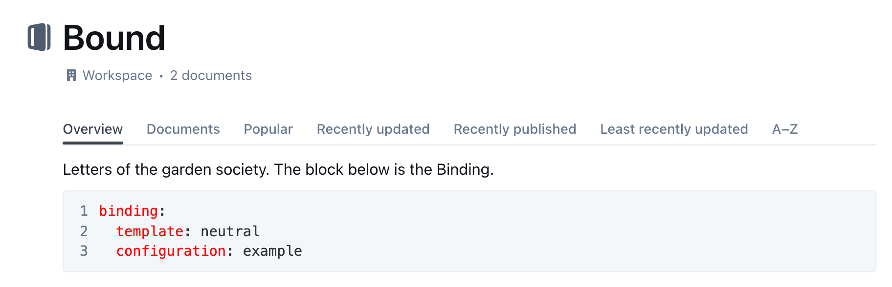

# Bind a Template to a Collection

**How-to.** Give a Collection its PDF look by adding a short block to its description in Outline.

The block names one **Template** (page design and kinds of document) and one
**Configuration** (the name, logo and colour of your organisation). The pair is
the **Binding**. Write it once; every document in the Collection, including
documents in folders below it, then offers **Export → Formatted PDF**. Authors
cannot change it.

You need to be allowed to edit the Collection, and the names of an installed
Template and Configuration. Ask the person who runs Outprint, or look in the
[Template catalogue](../templates/catalogue/README.md). The first Template,
`neutral`, comes with a Configuration called `example`. Outprint must already be
[installed](../install/README.md).

## Add the block

Open the Collection in Outline and edit its description. Add the fenced `yaml`
block anywhere in it, here after a title and one sentence:

<!-- validate: binding -->
````markdown
# Town Council

Notes and letters of the council.

```yaml
binding:
  template: neutral
  configuration: example
```
````

To make the block in Outline, type three backticks, choose **YAML** as the
language, type the lines inside and save. The change counts at once.



The block has exactly one key, `binding`, with `template` and `configuration`
below it. Both names must match an installed Template and Configuration, and the
pair must be one the person who runs Outprint allows. Use one block per
Collection. Every key and error is in the
[Binding block](../reference/binding-block.md) reference.

## Try it

1. Add the block to a test Collection.
2. Open a document in it. **Export → Formatted PDF** appears in the **…** menu.
3. Click it. The letterhead of the PDF shows the name and logo of the
   Configuration.

## What happens without a block

1. The Collection has a block: Outprint uses it. A mistake in the block is an
   error, not a silent fallback.
2. No block, but the installation has a default pair: Outprint uses that pair.
3. Neither: the author gets [`no_binding`](../reference/error-messages.md#no_binding),
   and a document shows no **Formatted PDF** at all.

A mistake in the block shows up when an author clicks **Formatted PDF**. The
action stays visible on purpose, so that the mistake is seen. The error says
`collection` and gives the line, counted from the first line of the description.
The codes are explained in
[Error messages](../reference/error-messages.md#binding_malformed).

## Where the action appears

By default **Formatted PDF** is in the **Export** menu. The person who runs
Outprint can move it to a header button before **Share** for everyone, and change
its labels. These are installation settings, not part of the Binding; see
[`OUTPRINT_BUTTON_PLACEMENT`](../reference/settings.md#outprint_button_placement)
and [`OUTPRINT_BUTTON_LABELS`](../reference/settings.md#outprint_button_labels).

Authors write the details of a document, such as the recipient, in the metadata
block of the document itself; see [Get a PDF](../write/get-a-pdf.md).
