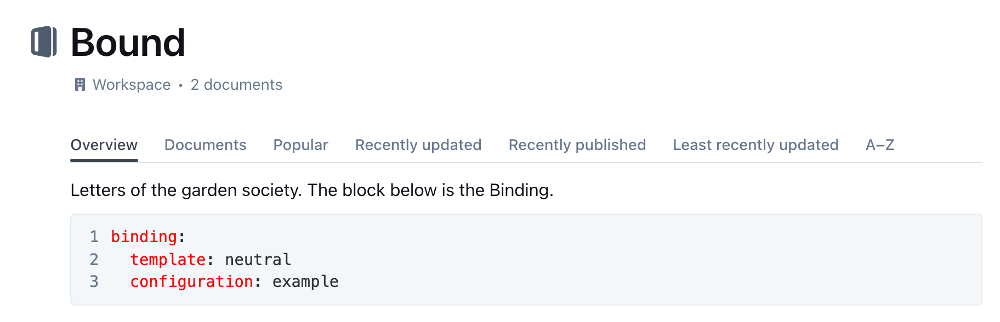

# Choose a Template and Configuration

**How-to.** Bind a Template and a Configuration to a Collection.

You give a Collection its PDF look by adding a short block to the Collection
description in Outline. The block names one Template and one Configuration. The
pair is called a **Binding**.

You need to be allowed to edit the Collection. You also need the names of an
installed Template and Configuration. Ask the person who runs Outprint, or look
at the [Template catalogue](../templates/catalogue/README.md). The first
Template, `neutral`, comes with a Configuration called `example`.

## Add the block

Open the Collection in Outline and edit its description. Add the block below
anywhere in the description. In the example the description is a title, one
sentence and the block. The part you add is the fenced `yaml` block.

<!-- validate: binding -->
````markdown
# Town Council

Notes and letters of the council.

```yaml
binding:
  template: neutral
  configuration: example
```
````

To make the block in Outline, type three backticks, choose **YAML** as the
language, and type the lines inside. Then save.

The change counts at once. Every document in the Collection, including documents
in folders below it, now offers **Formatted PDF** in its Export menu.



## The rules

The block has exactly one key, `binding`, with the keys `template` and
`configuration` below it. Both names must match an installed Template and
Configuration, and the pair must be one that the person who runs Outprint
allows. Use one block per Collection. Authors cannot change the Binding. Every
key and error is listed in [Binding block](../reference/binding-block.md).

## The subject of a letter

A letter without a `subject` in its own block gets the title of the Outline
document as its subject. This works with every Binding, so you need not set
anything in the Collection. Authors who want a letter without a subject line write
`subject:` with nothing after it, or `subject: ""`. A `subject` in the `defaults` of the
Configuration wins over the title.

## What happens without a block

1. The Collection has a block: Outprint uses it. A mistake in the block is an
   error, not a silent fallback.
2. The Collection has no block, and the installation has a default pair:
   Outprint uses the default pair.
3. Neither exists: the author gets the error
   [`no_binding`](../reference/error-messages.md#no_binding).

A document in a Collection without a Binding and without a default shows no
**Formatted PDF**.

## If something is wrong

Mistakes in the block show up when an author clicks **Formatted PDF**. The action
stays visible on purpose, so that the mistake is seen. The error says
`collection` and gives the line, counted from the first line of the description.
The codes (`binding_malformed`, `binding_unknown`, `binding_not_allowed`,
`binding_duplicate`, `no_binding`) are explained in
[Error messages](../reference/error-messages.md#binding_malformed).

## Try it

1. Add the block to a test Collection.
2. Open a document in it. **Export → Formatted PDF** appears in the **…** menu.
3. Click it. Open the PDF. The letterhead shows the name and logo of the
   Configuration.

If a document starts with a block of its own at the top, the author can add
details such as a recipient. See [Fill in the document](../write/fill-in-the-document.md).
