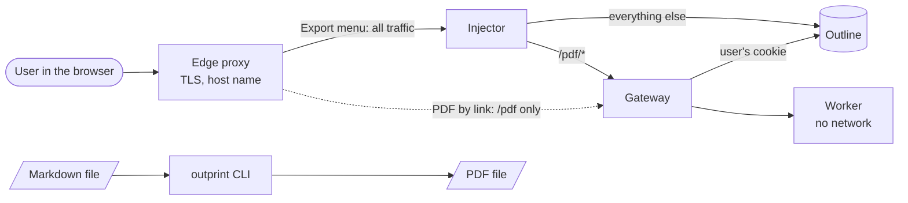

# Deploy

This section is for the person who runs Outline and Outprint. It shows how to
install Outprint next to an Outline you host.

Outline has no plug-in point, and Outprint does not change Outline. Outprint
runs next to it and talks to Outline through its API, with the cookie of the
signed-in user. There is no webhook and no API token. What differs between
installs is **how the user starts a PDF**. That gives three ways.

## Which way fits you?

Ask: how do you want to use Outprint?

| I want to... | Way | What you run |
|--------------|-----|--------------|
| click **Export → Formatted PDF** inside Outline | [Export menu in Outline](way-menu.md) | Gateway, Worker and injector; the injector sits in front of Outline |
| download a PDF from a link, and leave the way Outline is served as it is | [PDF by link](way-link.md) | Gateway and Worker; `/pdf` on the address of Outline goes to the Gateway |
| make PDFs from Markdown files, without Outline | [Command line](way-cli.md) | the `outprint` image only |

If you are unsure, take the first way. It is the one the browser tests cover.

Solid arrows are the Export menu way. The dotted arrow is the PDF by link way,
which skips the injector. The command line stands alone.

## What runs

| Part | Image | Needed by | What it does |
|------|-------|-----------|--------------|
| `gateway` | `outprint` | menu, link | Reads the document from Outline as the user, checks it, and asks the Worker for the PDF. |
| `worker` | `outprint` | menu, link | Typesets the PDF with Pandoc and LuaLaTeX. No network. |
| `injector` | `outprint-injector` | menu | Reverse proxy in front of Outline. Adds the script that draws the action. Routes `/pdf/*` to the Gateway. **Optional** for the link way. |
| `outprint` CLI | `outprint` | command line | `render` and `validate` run the same pipeline without Outline. |

## Combine the ways

The ways share parts, so they combine:

- **Link and menu** are one install. The menu way is the link way plus the
  injector. A link such as `/pdf/render/<id>` keeps working next to the menu.
- **The command line** can run next to either. It is also the quick check of a
  Template before you roll it out ([Command line](way-cli.md)).

A sensible order:

1. Read the [common base](common-base.md) and bring up Gateway and Worker.
2. Check that the link works ([PDF by link](way-link.md)). This proves the
   Gateway reaches Outline and the Worker renders.
3. Add the injector for the menu ([Export menu in Outline](way-menu.md)). It is
   the only step that touches how Outline is served.

Without the injector everything except the action in Outline's interface keeps
working.

## What Outprint does not do

- **No automatic PDFs on change.** Outprint reacts to a request from a user. It
  does not listen to Outline webhooks.
- **No API token.** The Gateway uses the cookie of the user, so Outline decides
  what the user may read. Nothing in Outprint holds a token for Outline.
- **No hosted Outline.** You need control over how Outline is served for the
  menu, and over the routes in front of it for the link.
- **No Helm chart and no Kubernetes manifests yet.** See
  [Helm and Kubernetes](helm-kubernetes.md).

## Where to go next

| Page | What it covers |
|------|----------------|
| [Common base](common-base.md) | What every way needs: images, Outline access, settings. |
| [Export menu in Outline](way-menu.md) | Gateway, Worker and injector, with a check and typical problems. |
| [PDF by link](way-link.md) | Gateway and Worker behind a route on the Outline address. |
| [Command line](way-cli.md) | `render` and `validate` without Outline. |
| [Docker Compose](docker-compose.md) | The shipped Compose file and the Worker baseline. |
| [Injector and PDF action](injector.md) | The injector in detail: settings, compression, CSP, button placement. |
| [Image fetching](image-fetching.md) | Which hosts the Gateway may fetch images from. |
| [Limits and admission control](limits-and-admission.md) | How large a document can be, and how many PDFs run at once. |
| [Security notes for operators](security-for-operators.md) | What to expose, what to keep inside, and what to check. |
| [Upgrading](upgrading.md) | What to check between versions. |
| [Compatibility with Outline](compatibility.md) | Which Outline versions were tested. |

Planned, not available yet: [Helm and Kubernetes](helm-kubernetes.md),
[Reverse-proxy recipes](reverse-proxy-recipes.md), [Podman](podman.md).

After the install, a Collection admin chooses a Template for each Collection.
See [Configure](../configure/README.md).
