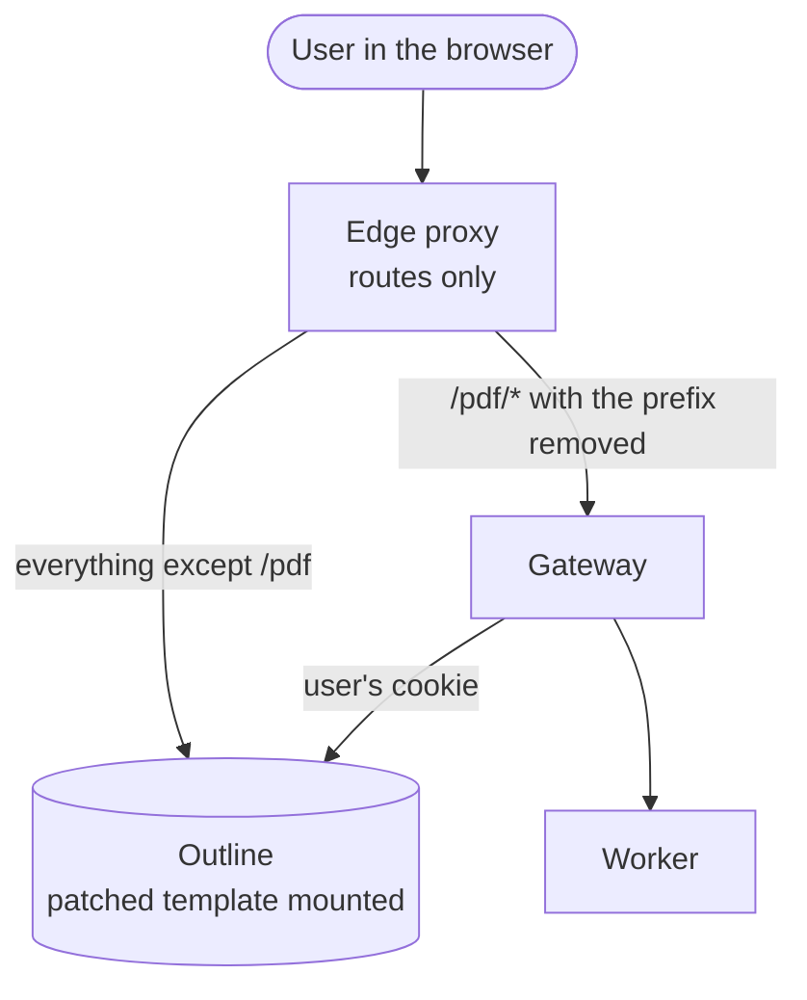

# Mounted page template

## What it does

Puts the **Formatted PDF** action into Outline without rewriting any page on the
way. Outline builds every page from one template file. You make a copy of that
file with the script tag already in it and mount the copy over the original, in
the Outline container:

```html
<script src="/pdf/button.js" defer></script>
```

What is left for the edge is routing `/pdf/*` to the Gateway, with the prefix
removed. That is plain proxying, which every proxy does.



A rewriting proxy has to deal with compressed HTML, cached `304` answers,
partial responses and the content policy. A page that already has the tag has none of them.

## When it fits

| | Injector | Edge-proxy recipe | Mounted template |
|---|---|---|---|
| Parts to run | one more container | none, if the proxy is there already | none |
| What you need | any proxy | a proxy that rewrites HTML | control of the Outline container (a file mount) |
| Page rewriting at runtime | yes | yes | no |
| Compression, `304`, ranges, `HEAD` | handled by the injector | proxy specific, see each recipe | not an issue |
| Outline's CSP | `OUTPRINT_INJECTOR_CSP_ALLOW_SELF` | by hand | usually nothing, see [CSP](#content-security-policy) |
| Options (`OUTPRINT_BUTTON_*`) | environment variables | `data-` attributes | `data-` attributes |
| After an Outline upgrade | nothing | nothing | **regenerate the file** |
| Covered by the browser tests | yes | nginx only | yes |

**Limits.** This does not work where you cannot mount a file into Outline: hosted
Outline, or a platform that does not allow it. It ties one file to one Outline
version, see [Upgrade](#upgrade).

## Where the template is

Checked in `outlinewiki/outline:1.12.0`:

| | |
|---|---|
| The file the production server reads | `/opt/outline/build/app/index.html` |
| When it is read | once, on the first page request, then kept in memory. A change needs a **restart** of the Outline container |
| Another copy | `/opt/outline/server/static/index.html`. Identical in 1.12.0, but only read in development and test mode. Mounting over it does nothing |
| Owner | `nodejs` (uid 1001); the file is world-readable, a read-only mount works |

The server fills `{placeholders}` in the file (`{env}`, `{script-tags}`, `{title}`
and others) with a global replace, then sends the page. The patched copy keeps
all of them and adds the tag before `</body>`. A tag with braces is refused by the
script, since the server would rewrite it.

The path comes from `build/server/routes/app.js` of the image (`readIndexFile`).
Outline may move it in a later release; the script fails when the file is not at
the path, and does not guess.

## Generate the patched file

`scripts/patch-outline-template.sh` takes the template from the image you will
mount it into, so the two always match:

```sh
./scripts/patch-outline-template.sh outlinewiki/outline:1.12.0 ./outline-index.html
```

It refuses to continue when the template does not have exactly one `</body>`, or
already has the tag. `OUTPRINT_SCRIPT_TAG` replaces the tag, for example to add
`data-` options ([Options](reverse-proxy-recipes.md#options)). Docker is the only
requirement.

## Install

Mount the file read-only. Docker Compose:

```yaml
services:
  outline:
    image: outlinewiki/outline:1.12.0
    volumes:
      - ./outline-index.html:/opt/outline/build/app/index.html:ro
```

Kubernetes: put the file in a ConfigMap (generate it in CI) and mount that key
with `subPath: index.html` at the same path, so the rest of `build/app` stays.

Route `/pdf/*` to the Gateway with the prefix removed, as in
[PDF by link](../ways/pdf-by-link.md). Do not use the injector or a rewriting
recipe at the same time: the tag would appear twice.

## Content-Security-Policy

In production Outline allows scripts from its own `URL`, which is the origin the
script comes from. No change is needed while `/pdf` is on that host name. With
another `URL`, or a policy that lists `script-src` without that origin, the browser
blocks the script and the console says so; see
[CSP](reverse-proxy-recipes.md#content-security-policy).

## Upgrade

1. Pull the new Outline image.
2. Generate the file again from **that** image.
3. Restart Outline with the new file.

Keep the file in step with the tag of the image. A copy from an older release
would bring back the old page, and the application loaded by it may no longer
match the server. A pipeline that builds the file from the image it deploys
avoids this.

## Is it stable?

The tag is one line in a file that the Outline project treats as its own
internal. Outline has no promise to keep its place or form. Two things keep the
risk small:

- The script is only added to a page, nothing is changed in it. If Outline moves
  the file, the mount has no effect and the action is missing. Nothing else
  breaks.
- The browser tests run against the pinned Outline (`task e2e:run-template`), so
  a bump of the pin shows a change before it reaches you.

Tested: Outline 1.12.0. Other versions: untested, see
[Compatibility with Outline](../operate/compatibility.md).

## Check that it works

1. The page carries the tag once:

   ```sh
   curl -s -H 'Accept: text/html' https://wiki.example.test/ | grep -c 'pdf/button.js'
   ```

   `1` is right. `0` means the mount is not in the container, was made over the
   wrong path, or Outline was not restarted.
2. `curl -i https://wiki.example.test/pdf/healthz` answers `200`.
3. Sign in and open a document of a bound Collection: **Export → Formatted PDF**
   appears.

## Typical problems

| What you see | Cause | What to do |
|--------------|-------|-----------|
| check 1 prints `0` | wrong path, no restart, or the mount covers another file | mount at `/opt/outline/build/app/index.html`; restart the container |
| `0`, and the mount is at `server/static/index.html` | that copy is only read in development mode | use the `build/app` path |
| the tag appears twice | the injector or a recipe is active as well | use one of them |
| the page is old after an upgrade | the file is from the previous release | [generate it again](#upgrade) |
| `404` from `/pdf/...` | the prefix is not removed | see [PDF by link](../ways/pdf-by-link.md#typical-problems) |
