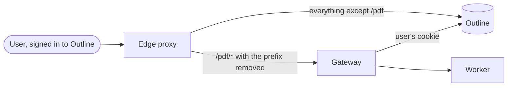

# Way 2: PDF by link

## What it does

A user downloads a PDF by opening an address in the browser while signed in to
Outline. There is no action in Outline's interface. You do not put anything in
front of Outline except one route.

```text
https://wiki.example.test/pdf/render/<urlId>
```

`<urlId>` is the last part of the document's address. For
`https://wiki.example.test/doc/quarterly-report-AbC123xyz` it is `AbC123xyz`.
The script in Outline uses the same rule.



## When it fits

- You want PDFs soon and do not want to change how Outline is served.
- You link to the PDF from somewhere else, for example a Collection overview or
  a bookmark.
- You want to try the Gateway before you add the injector.

It does not fit when authors should find the PDF in Outline's menu. Take the
[Export menu](way-menu.md) then. The two ways share the Gateway and the Worker,
so you can start here and add the injector later.

## Prerequisites

- The [common base](common-base.md), including the Gateway and the Worker
  running and the checks passing.
- An edge proxy that serves Outline, and that you can give one more route.
- The route must keep **one host name**. The Gateway has no login of its own.
  The browser sends Outline's cookie only to the host of Outline, so the Gateway
  must be served there, below `/pdf`.
- A Binding on the Collection of the document ([Configure](../configure/README.md)).

## Install

### Docker Compose

Start the Gateway and the Worker as in the
[common base](common-base.md#start-gateway-and-worker). Then add the route at
your edge proxy: requests below `/pdf/` go to the Gateway, with the prefix
removed. The Gateway answers `/render/...`, `/status/...`, `/button.js` and
`/healthz` and knows nothing of `/pdf`.

This nginx fragment shows the shape. **Untested** with Outprint; it is the usual
way to strip a prefix:

```nginx
location /pdf/ {
    proxy_pass http://gateway.internal.example.invalid:8080/;
    proxy_set_header Host $host;
}
```

Do not publish the Gateway's own port. The Compose file publishes it for trying
things out.

### Kubernetes

Not available. See [Helm and Kubernetes](helm-kubernetes.md).

## Check that it works

1. `curl -i https://wiki.example.test/pdf/healthz` answers `200`.
2. Sign in to Outline in the browser and open a document of a bound Collection.
3. In the same browser, open `https://wiki.example.test/pdf/render/<urlId>`.
   A PDF downloads.
4. Without the cookie, `curl -i https://wiki.example.test/pdf/render/<urlId>`
   answers `401`.

## Typical problems

| What you see | Cause | What to do |
|--------------|-------|-----------|
| `404` from the edge proxy or from Outline | the route is missing, or the prefix is not removed | the Gateway has no `/pdf` route; strip the prefix |
| `401` in the browser although you are signed in | the Gateway is on another host name than Outline | serve it below `/pdf` on the host of Outline |
| JSON error with a message about a Binding or the Metadata Block | the document or its Collection is not set up | see [When something goes wrong](../write/when-something-goes-wrong.md) |
| `429` with `Retry-After` | the render queue is full | wait, or raise the limits ([Limits and admission control](limits-and-admission.md)) |

## Other ways to show an action without the injector

Outprint ships none. The script `/pdf/button.js` works wherever it is loaded
from the Outline origin, for example by a proxy that rewrites the HTML, or by a
browser extension or userscript that adds the `<script>` tag. **Untested.** Both
need the `/pdf` route above and a Content-Security-Policy that allows the
script. The injector is the way the browser tests cover.
