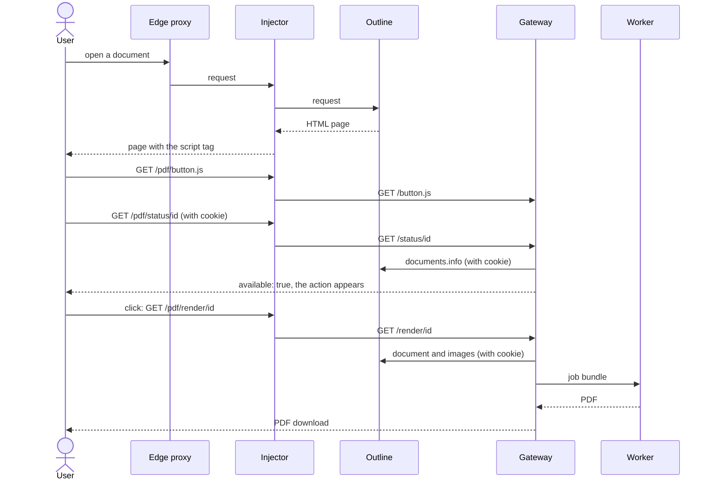

# Export menu in Outline

## What it does

Users get **Export → Formatted PDF** in the menu of a document, inside Outline.
One click downloads the PDF. You can move the action to a header button
([Where the PDF action appears](../../configure/pdf-action.md)).

Outline has no plug-in point for menus. So a small reverse proxy, the
**injector**, sits in front of Outline and adds one `<script>` tag to its pages.
The script draws the action and calls the Gateway.



## When it fits

- Authors should find the PDF where they already work.
- You control the proxy in front of Outline, or can put one there.

If you only need a link, [PDF by link](pdf-by-link.md) is smaller. The injector is
an addition to the Gateway and the Worker. **Without it, everything else keeps
working**: the Gateway renders, the link way works, the command line works. Only
the action in Outline's interface is missing.

## Prerequisites

- The [common base](../common-base.md): a self-hosted Outline, Docker, the
  `outprint` image, access from the Gateway to Outline.
- The `outprint-injector` image. The Compose file builds it from the checkout
  (`injector` target of the Dockerfile).
- A way to make the injector the public front of Outline. The edge proxy keeps
  TLS and the host name and sends everything to the injector.
- `OUTPRINT_INJECTOR_UPSTREAM`: the address at which the injector reaches
  Outline. It must be reachable from the Compose `frontend` network.

## Install

### Docker Compose

```sh
export OUTLINE_URL=https://wiki.example.test                # as the Gateway reaches Outline
export OUTPRINT_INJECTOR_UPSTREAM=http://outline:3000       # as the injector reaches Outline
export OUTPRINT_WORKER_TOKEN="$(openssl rand -hex 32)"      # optional

docker compose -f deploy/compose/compose.yaml up --build
```

This starts the Worker, the Gateway and the injector. The injector publishes
port 8090 (`OUTPRINT_INJECTOR_PORT`). Point your edge proxy at it instead of at
Outline. Publish the injector only, not the Gateway's port.

The Compose file already points the injector at the Gateway
(`OUTPRINT_INJECTOR_GATEWAY_URL`, prefix `/pdf`). The button options
(`OUTPRINT_BUTTON_*`) are Gateway settings, see [The script tag](../components/script-tag.md#options-come-from-the-gateway).
The other injector settings (the Content-Security-Policy switch, timeouts) are on
[Injector and PDF action](../components/injector.md#configuration).

### Kubernetes

Not available. There is no Helm chart and there are no manifests yet; see
[Helm and Kubernetes](../platforms/helm-kubernetes.md).

### Edge proxy

A worked example for Traefik is in
[Injector and PDF action](../components/injector.md#routing-example). Other proxies follow the
same shape: `edge proxy -> injector -> Outline`.

If you control the Outline container but not the proxy in front of it, the
[mounted page template](../components/mounted-template.md) puts the tag into the
page itself, so nothing has to be rewritten on the way.

If you already run nginx, Caddy or Traefik in front of Outline and it can rewrite
the HTML, you can skip the injector: [Reverse-proxy recipes](../components/reverse-proxy-recipes.md)
add the same script tag at the edge. They give less (no CSP rewrite, no option
checks); the page has the comparison.

## Check that it works

The shared check, with how to read the browser console, is on
[The script tag](../components/script-tag.md#check). With the injector:

1. `curl -i http://localhost:8090/_injector/healthz` answers `200`.
2. Open Outline at the injector's address and sign in.
3. Open a document in a Collection that has a Binding
   ([Configure](../../configure/README.md)).
4. Open **…** and then **Export**. **Formatted PDF** is listed after the file
   formats.
5. Click it. A PDF downloads.

Also check that the Gateway and the Worker cannot be reached from outside; the
list is in [Security notes](../operate/security-for-operators.md#check-after-the-install).

## Typical problems

| What you see | Cause | What to do |
|--------------|-------|-----------|
| No **Formatted PDF** anywhere | the Collection has no Binding | add the block in [Configure](../../configure/choose-a-template.md); the action shows only on bound documents |
| No action, and the console reports a blocked script | Outline's Content-Security-Policy | set `OUTPRINT_INJECTOR_CSP_ALLOW_SELF=true`; see [Content-Security-Policy](../components/injector.md#content-security-policy) |
| Outline works, the action never appears | you reach Outline directly and not through the injector | open the injector's address |
| A small floating button instead of the menu entry | the script did not find Outline's menu | the console says why; check [Compatibility](../operate/compatibility.md) |
| Pages load without the action and the injector logs a warning | the page is compressed with `br` or `zstd` | compress at the edge proxy and not in Outline; see [Compression](../components/injector.md#compression) |
| `401` or `403` on click | the Gateway is not on the host of Outline, so the cookie does not arrive | route `/pdf` through the injector |
| `502` from the injector | corrupt gzip body from Outline, or Outline is unreachable | check `OUTPRINT_INJECTOR_UPSTREAM` and the injector log |
| The action shows, a click fails with a message | the document is wrong, not the install | the panel shows what to fix; see [When something goes wrong](../../write/when-something-goes-wrong.md) |
