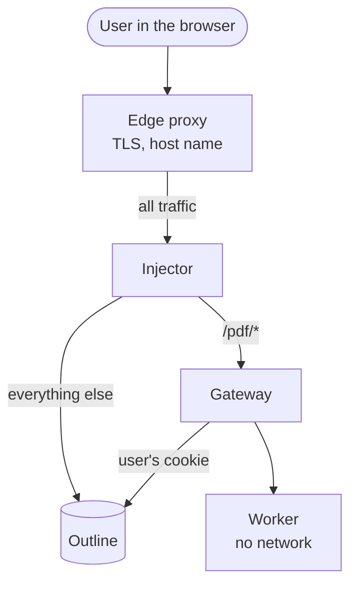

# Install Outprint

**How-to.** Install Outprint next to an Outline you host. This section is for the person who runs Outline and Outprint.

Outline has no plug-in point, and Outprint does not change Outline. Outprint
runs next to it and talks to Outline through its API, with the cookie of the
signed-in user. There is no webhook and no API token. What differs between
installs is **how the Formatted PDF action gets into Outline's pages**.

## Which way fits you?

Both ways give the **Export → Formatted PDF** action inside Outline. They differ
only in how the [script tag](components/script-tag.md) gets into Outline's pages.
If you are unsure, take the injector. It is the one the browser tests cover. The install has
the same shape in both: route `/pdf` to the Gateway, add the bare tag,
set the options on the Gateway, run the [shared check](components/script-tag.md#check).

| | Injector | Edge-proxy recipe |
|---|---|---|
| What you run | one more container in front of Outline | nothing new, a rule in your nginx, Caddy or Traefik |
| What you must control | the route to Outline | the edge proxy, and it must rewrite HTML |
| Effort | lowest to set up | a rule per proxy |
| How fragile | handles compression, `304` and CSP for you | depends on the proxy; no CSP rewrite |
| Page | [Injector](components/injector.md) | [Recipes](components/reverse-proxy-recipes.md) |

The [recipes](components/reverse-proxy-recipes.md) replace the injector box by a
rewrite in the edge proxy.

## What runs

| Part | Image | What it does |
|------|-------|--------------|
| `gateway` | `outprint` | Reads the document from Outline as the user, checks it, and asks the Worker for the PDF. |
| `worker` | `outprint` | Typesets the PDF with Pandoc and LuaLaTeX. No network. |
| `injector` | `outprint-injector` | Reverse proxy in front of Outline. Adds the script that draws the action. Routes `/pdf/*` to the Gateway. **Optional**: replaceable by a [recipe](components/reverse-proxy-recipes.md) for the action. |

## Order of work

A sensible order:

1. Read the [common base](common-base.md) and bring up Gateway and Worker.
2. Check that a render works: open `/pdf/render/<id>` on the address of the
   Gateway while signed in to Outline. This proves the Gateway reaches Outline
   and the Worker renders.
3. Add the action to Outline ([Export menu in Outline](ways/export-menu.md)) with the
   injector or an edge-proxy recipe. It is the only step that touches how
   Outline is served.

Without the injector everything except the action in Outline's interface keeps
working.

## What Outprint does not do

- **No automatic PDFs on change.** Outprint reacts to a request from a user. It
  does not listen to Outline webhooks.
- **No API token.** The Gateway uses the cookie of the user, so Outline decides
  what the user may read. Nothing in Outprint holds a token for Outline.
- **No hosted Outline.** You need control over how Outline is served for the
  action, and over the routes in front of it.
- **Kubernetes through the Helm chart.** The chart lives in
  [taskmedia/helm](https://github.com/taskmedia/helm/tree/main/charts/outprint);
  see [Helm and Kubernetes](platforms/helm-kubernetes.md). There are no plain manifests.

## Where to go next

| Group | Pages |
|-------|-------|
| Start here | [Common base](common-base.md): what every way needs, images, Outline access, settings. |
| Add the action | [Export menu in Outline](ways/export-menu.md). |
| Platforms | [Docker Compose](platforms/docker-compose.md), the shipped Compose file and the Worker baseline. [Helm and Kubernetes](platforms/helm-kubernetes.md), the chart from taskmedia/helm. |
| Components | [Injector and PDF action](components/injector.md), [Image fetching](components/image-fetching.md), [Limits and admission control](components/limits-and-admission.md). [Reverse-proxy recipes](components/reverse-proxy-recipes.md): nginx, Caddy and Traefik instead of the injector. |
| Operate | [Security notes for operators](operate/security-for-operators.md), [Upgrading](operate/upgrading.md), [Compatibility with Outline](operate/compatibility.md). |

After the install, a Collection admin chooses a Template for each Collection.
See [Configure](../configure/README.md).
