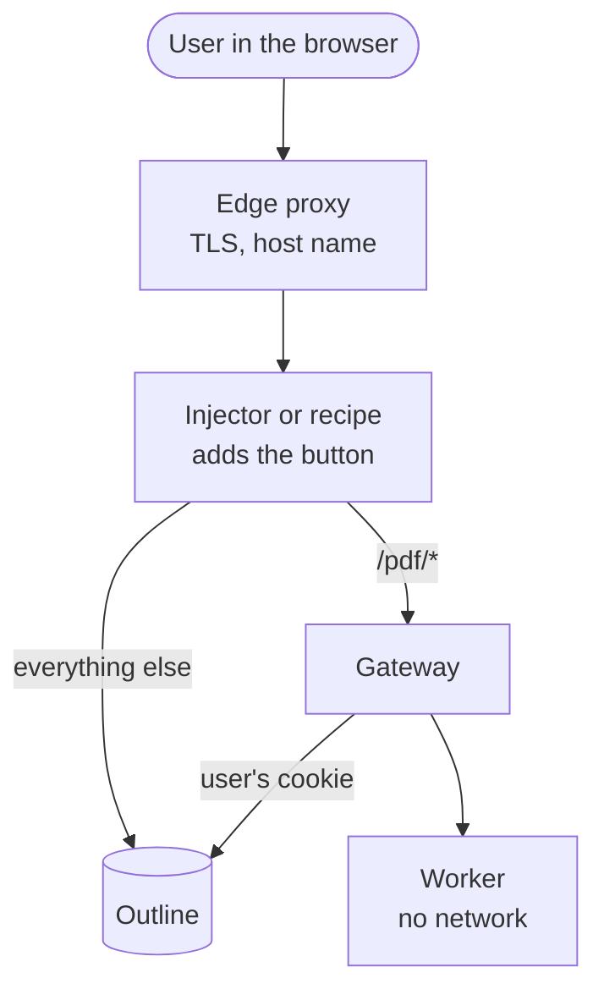

# Install Outprint

**How-to.** Install Outprint next to an Outline you host, in three steps. This section is for the person who runs Outline and Outprint.

Outline has no plug-in point, and Outprint does not change Outline. Outprint
runs next to it and reads documents through Outline's API with the cookie of the
signed-in user. There is no webhook and no API token. You need a self-hosted
Outline whose address you control; hosted Outline cannot be used.

## The three steps

1. **[Run Outprint](run-outprint.mdx).** Start the Gateway and the Worker with
   Docker Compose or Helm.
2. **[Add the button](add-the-button.mdx).** Make **Export → Formatted PDF**
   appear in Outline, with the injector or an edge-proxy recipe.
3. **[Bind a Template to a Collection](../configure/README.md).** A Collection
   admin picks the look. This step is in Configure, not here.

## Two decisions

Everything else is the same for every install.

| Decision | Choices | Take the first if |
|----------|---------|-------------------|
| Platform (step 1) | Docker Compose, Helm | you run containers on one host. Take Helm for Kubernetes. |
| Button (step 2) | Injector, edge-proxy recipe | you are unsure. The injector is one more container and handles compression, `304` and CSP for you. Take a recipe if nginx, Caddy or Traefik already fronts Outline and can rewrite HTML. |

## How it fits together

The browser talks to one address, the one of Outline. `/pdf/*` on that address
reaches the Gateway, which is why Outline's cookie arrives there. Publish the
injector or the proxy, never the Gateway or the Worker.

## What Outprint does not do

Outprint makes a PDF when a user asks for it; it does not listen to Outline's
webhooks, keeps no copy of a document or a PDF, and never holds an Outline
token.

## Operate

- [Upgrade Outprint](operate/upgrading.md): what to check between versions.
- [Secure the install](operate/security-for-operators.md): what to expose, what to keep inside.
- [Check compatibility with Outline](operate/compatibility.md): the tested Outline releases.
- [Tune limits](operate/limits-and-admission.md): admission control for many users.

Every setting is in the [Settings reference](../reference/settings.md).
