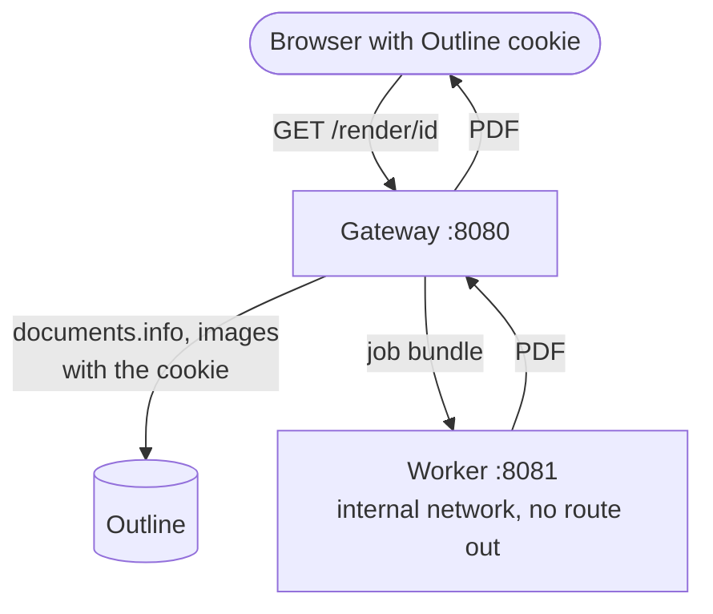

# Prepare the common base

**How-to.** Set up what every install needs: images, access to Outline and settings.

What the [Export menu](ways/export-menu.md) needs, however the action gets into Outline.
The pages of the install refer here and do not repeat it.

## What you need

1. **A self-hosted Outline.** Hosted Outline (the cloud service of the Outline
   company) cannot be used: you cannot control the address it is served on. The
   tested versions are listed in [Compatibility](operate/compatibility.md).
2. **Docker and Docker Compose,** or a Kubernetes cluster with Helm
   ([Helm and Kubernetes](platforms/helm-kubernetes.md)).
3. **The `outprint` image**, for the Gateway and the Worker. The Compose file
   builds it from the repository checkout (`docker compose ... up --build`).
   The release workflow is meant to publish `ghcr.io/taskmedia/outprint`. Check
   that the tag exists before you depend on it.
4. **Network access from the Gateway to Outline.** The Gateway calls Outline's
   API. Use an internal address if you have one.
5. **One address for the user.** The browser must send Outline's session cookie
   to the Gateway. That works when the Gateway is served on the host name of
   Outline, below `/pdf`. See [Security notes](operate/security-for-operators.md).

There is no Outline API token to create. The Gateway forwards the cookie of the
user who asks, so Outline's own permissions decide what is visible.

## What runs



The Worker has no network and no secrets. The Gateway is the only part that
talks to Outline. Why they are split: [ADR 0001](https://github.com/taskmedia/outprint/blob/main/docs/adr/0001-split-renderer-into-gateway-and-worker.md).

## Settings

Set these on the Gateway (and the Worker where noted). The Compose file passes
them through from your shell.

| Variable | Where | Meaning | Default |
|----------|-------|---------|---------|
| `OUTLINE_URL` | Gateway | base URL of Outline, as the Gateway reaches it; **required** | |
| `OUTLINE_PUBLIC_URL` | Gateway | the URL Outline names itself, when `OUTLINE_URL` is an internal address; see [Image fetching](components/image-fetching.md) | none |
| `OUTPRINT_WORKER_URL` | Gateway | base URL of the Worker; **required** (the Compose file sets it) | |
| `OUTPRINT_WORKER_TOKEN` | Gateway, Worker | optional shared token; the same value on both | none |
| `OUTPRINT_LISTEN` | both | listen address | `:8080` Gateway, `:8081` Worker |
| `OUTPRINT_SERVICE_CONFIG` | both | service configuration file | the one in the image |
| `OUTPRINT_PORT` | Compose | published port of the Gateway | `8080` |

Templates, Configurations, the allowed Bindings and the image hosts are in the
service configuration (`config/service.yaml`). Limits and the admission
settings are on [Limits and admission control](components/limits-and-admission.md).

## Start Gateway and Worker

```sh
export OUTLINE_URL=https://wiki.example.test      # your Outline
# optional: a token shared by Gateway and Worker
export OUTPRINT_WORKER_TOKEN="$(openssl rand -hex 32)"

docker compose -f deploy/compose/compose.yaml up --build gateway worker
```

The Compose file also has an `injector` service. Naming only `gateway` and
`worker` leaves it out. What the file sets for the Worker is explained in
[Docker Compose](platforms/docker-compose.md).

## Check the base

1. `curl -i http://localhost:8080/healthz` answers `200`.
2. `curl -i http://localhost:8080/render/anything` answers `401` with a JSON
   message "sign in to Outline to download this document". The Gateway is up
   and asks for a session.
3. `docker compose -f deploy/compose/compose.yaml ps` shows `gateway` and
   `worker` as `healthy`.

A real PDF needs a signed-in browser. The next step is adding the action to Outline.

## Typical problems

| What you see | Cause | What to do |
|--------------|-------|-----------|
| `outprint: gateway needs OUTLINE_URL and OUTPRINT_WORKER_URL` | one of the two is empty | set `OUTLINE_URL` before `docker compose up`; the Compose file sets the Worker address |
| `500` with the log line `outline: unavailable` | the Gateway cannot reach `OUTLINE_URL` | test from inside the Gateway's network; use the address the Gateway can reach, not the public one |
| `401` in the browser although you are signed in | the cookie does not reach the Gateway | the Gateway is on another host name; serve it below `/pdf` on the host of Outline |
| the Gateway waits for the Worker and does not start | the Worker is not healthy | `docker compose logs worker`; the Worker refuses to start as UID 0 |
