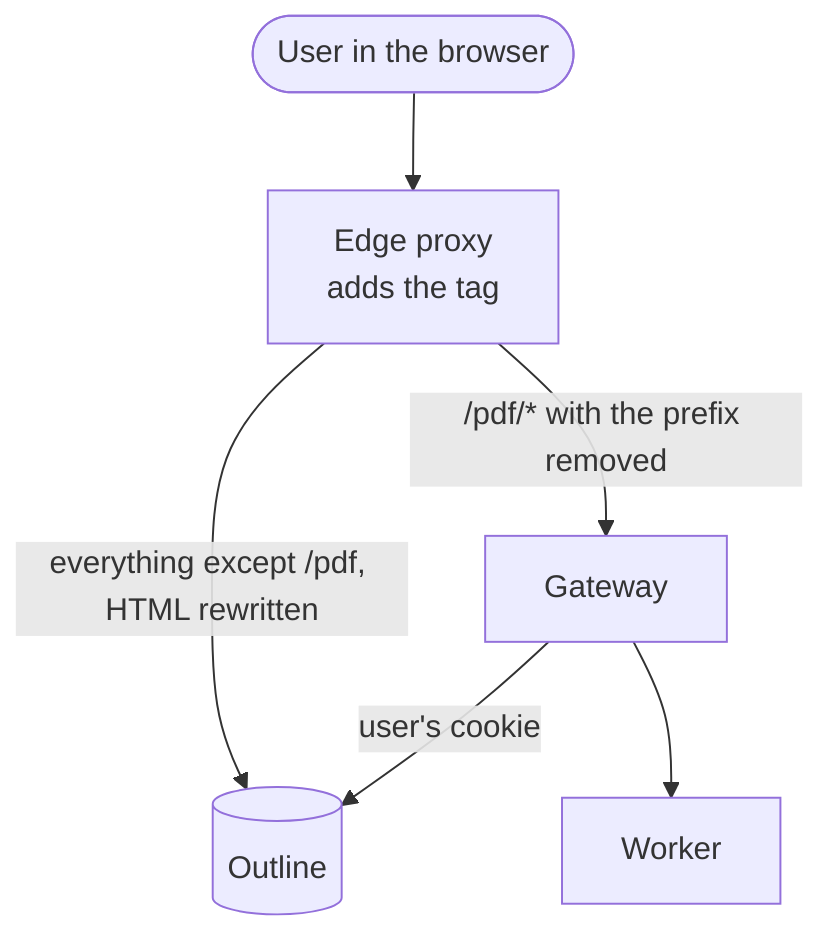

# Edge-proxy recipes

**Background.** The rules, caveats and checks behind the nginx, Caddy and Traefik recipes.

The snippets to copy are in [Add the button](../install/add-the-button.mdx). This page
has what stands behind them.

## What it does

Puts the **Formatted PDF** action into Outline with your own edge proxy, without
running the [injector](injector.md). The proxy does the two things the injector
does:

1. It routes `/pdf/*` to the Gateway, with the prefix removed.
2. It adds the bare tag to Outline's HTML pages:

   ```html
   <script src="/pdf/button.js" defer></script>
   ```

The tag is the one in [The script tag](script-tag.md). Options come from the
Gateway, see [Options](#options).



## When it fits

| | Injector | Edge-proxy recipe |
|---|---|---|
| Parts to run | one more container | none, if the proxy is there already |
| Proxy needed | any | nginx (stock), Caddy (plugin), Traefik (plugin) |
| Options (`OUTPRINT_BUTTON_*`) | environment variables, checked at startup | `data-` attributes you write into the tag |
| Gzip HTML from Outline | decoded and rewritten | nginx and Caddy: avoided with `Accept-Encoding: identity`; Traefik plugin: decoded |
| Outline's CSP | `OUTPRINT_INJECTOR_CSP_ALLOW_SELF` adds `'self'` | by hand, see [CSP](#content-security-policy) |
| `HEAD`, range requests, `206`, `304` | never rewritten | depends on the proxy, see each recipe |
| A page that already has the tag | detected, not touched twice | not detected |
| Health check | `GET /_injector/healthz` | none from Outprint |
| Covered by the browser tests | yes | nginx only |

Take the injector if you are unsure, or if your proxy cannot rewrite bodies.
Take a recipe if such a proxy already fronts Outline and you do not want one
more part. The Gateway and the Worker are the same for both
([Run Outprint](../install/run-outprint.mdx)).

## Prerequisites

- [Run Outprint](../install/run-outprint.mdx) done, with the Gateway and the Worker running
  and `/pdf/render/<id>` rendering a PDF while you are signed in.
- **One host name** for Outline and for `/pdf`. The Gateway has no login of its
  own; it needs the cookie Outline set.
- Not both: with the injector in front, leave the recipe out, or the tag
  appears twice.

## What every recipe has to do

| Rule | Why |
|------|-----|
| Route `/pdf/*` to the Gateway with the prefix removed; `GET` and `HEAD` only | the Gateway knows nothing of `/pdf` |
| Ask Outline for uncompressed HTML on navigations (`Accept-Encoding: identity`) | a rewrite cannot read `br` or `zstd`; such a page is skipped and the action is missing |
| Drop `If-None-Match` and `If-Modified-Since` on navigations | a `304` sends the browser back to a copy cached before the tag existed |
| Rewrite only complete HTML pages: `text/html`, status 200 | JSON, scripts, images, event streams and the collaboration WebSocket must pass unchanged |
| Insert the tag once | two tags load the script twice |
| Keep the public `Host` | Outline checks the origin |

Where a recipe cannot do one of these, it says so.

## nginx

**Status: tested.** The browser tests run against this configuration
(`deploy/dev/nginx/nginx.conf`, `task e2e:run-nginx`). It needs only stock nginx:
`ngx_http_sub_module` is in the official images and in most distribution
packages (`nginx -V` shows `--with-http_sub_module`).

The `map` blocks belong in the `http` context. An empty header value makes nginx
leave the header out.

```nginx
map $http_upgrade $connection_upgrade {
    default upgrade;
    ""      close;
}

# A navigation asks for HTML. Only those get the special treatment.
map $http_accept $navigation {
    default       0;
    "~*text/html" 1;
}
map $navigation $upstream_accept_encoding {
    0 $http_accept_encoding;
    1 "identity";
}
map $navigation $upstream_if_none_match {
    0 $http_if_none_match;
    1 "";
}
map $navigation $upstream_if_modified_since {
    0 $http_if_modified_since;
    1 "";
}

server {
    listen 443 ssl;
    server_name wiki.example.test;
    # ssl_certificate ... as for any server

    location /pdf/ {
        limit_except GET HEAD { deny all; }
        proxy_pass http://gateway.internal.example.invalid:8080/;
        proxy_set_header Host $http_host;
        proxy_set_header X-Forwarded-For $proxy_add_x_forwarded_for;
        proxy_set_header X-Forwarded-Proto $scheme;
        proxy_read_timeout 5m;   # a render may wait in the queue
    }

    location / {
        proxy_pass http://outline.internal.example.invalid:3000;
        proxy_http_version 1.1;
        proxy_set_header Host $http_host;
        proxy_set_header X-Forwarded-For $proxy_add_x_forwarded_for;
        proxy_set_header X-Forwarded-Proto $scheme;
        proxy_set_header Upgrade $http_upgrade;
        proxy_set_header Connection $connection_upgrade;
        proxy_set_header Accept-Encoding $upstream_accept_encoding;
        proxy_set_header If-None-Match $upstream_if_none_match;
        proxy_set_header If-Modified-Since $upstream_if_modified_since;

        sub_filter '</body>' '<script src="/pdf/button.js" defer></script></body>';
        sub_filter_once on;
    }
}
```

**`X-Forwarded-For`.** `$proxy_add_x_forwarded_for` appends the client address to
whatever `X-Forwarded-For` the client sent, so a client can forge the earlier
entries. That is right when another trusted proxy sits in front of this one. When
this proxy is the first hop from the internet, use `$remote_addr` instead:
`proxy_set_header X-Forwarded-For $remote_addr;`. The same goes for the Caddy and
Traefik recipes: trust forwarded headers only from a hop you run.

What this does and does not do:

- `sub_filter` rewrites `text/html` only (its default type list). JSON, scripts,
  images, event streams and WebSocket frames pass unchanged.
- `sub_filter_once on` inserts at the first `</body>`. Outline's pages have one.
- nginx does **not** limit the rewrite to status 200: an HTML error page from
  Outline gets the tag too. That is harmless, the script acts on document pages
  only.
- A tag that is already there is not detected. Add it in one place.
- If Outline answers with compressed HTML anyway, `sub_filter` leaves the page
  alone and the action is missing. Check 3 below shows it.
- Compression towards the browser is yours: `gzip on;` is applied after
  `sub_filter`.

## Caddy

**Status: untested.** Caddy cannot rewrite a body by itself. You need the
third-party module [`replace-response`](https://github.com/caddyserver/replace-response)
built into Caddy (for example with `xcaddy`). Its directive is `replace`, which
registers after `encode`.

<!-- validate: skip Caddyfile, a third-party format -->
```caddyfile
wiki.example.test {
    handle_path /pdf/* {
        reverse_proxy http://gateway.internal.example.invalid:8080
    }

    handle {
        @navigation header Accept *text/html*
        reverse_proxy http://outline.internal.example.invalid:3000 {
            header_up @navigation Accept-Encoding identity
            header_up @navigation -If-None-Match
            header_up @navigation -If-Modified-Since
        }
        replace {
            match {
                header Content-Type text/html*
                status 200
            }
            "</body>" `<script src="/pdf/button.js" defer></script></body>`
        }
    }
    encode zstd gzip
}
```

- `reverse_proxy` passes the WebSocket upgrade and keeps the public `Host`.
- The `match` block limits the rewrite to HTML with status 200. Without `stream`
  the module buffers the page, which is right for HTML.
- `replace` replaces every match. Outline's pages have one `</body>`; a page
  with two would carry two tags.
- The syntax is from the module's README. Check it against the version you build.

## Traefik

**Status: untested.** Traefik has no body-rewrite middleware of its own; a
plugin does it. This recipe is written for the community plugin
[`packruler/rewrite-body`](https://github.com/packruler/rewrite-body). Traefik
loads plugins from its plugin catalog at startup (so it needs access to it) and
runs them in an interpreter.

<!-- validate: skip Traefik static configuration, a third-party format -->
```yaml
# static configuration
experimental:
  plugins:
    rewrite-body:
      moduleName: github.com/packruler/rewrite-body
      version: v1.1.0   # pin the version you tested
```

<!-- validate: skip Traefik dynamic configuration, a third-party format -->
```yaml
# dynamic configuration
http:
  middlewares:
    outprint-tag:
      plugin:
        rewrite-body:
          rewrites:
            - regex: "</body>"
              replacement: '<script src="/pdf/button.js" defer></script></body>'
          monitoring:
            methods: [GET]
            types: [text/html]
    outprint-strip-pdf:
      stripPrefix:
        prefixes: [/pdf]
  routers:
    gateway:
      rule: Host(`wiki.example.test`) && PathPrefix(`/pdf/`)
      entryPoints: [websecure]
      middlewares: [outprint-strip-pdf]
      service: gateway
      priority: 20
      tls: {}
    wiki:
      rule: Host(`wiki.example.test`)
      entryPoints: [websecure]
      middlewares: [outprint-tag]
      service: outline
      priority: 10
      tls: {}
  services:
    gateway:
      loadBalancer:
        servers:
          - url: http://gateway.internal.example.invalid:8080
    outline:
      loadBalancer:
        servers:
          - url: http://outline.internal.example.invalid:3000
```

- The plugin decodes gzip, rewrites and encodes again, so the `identity` rule
  matters less. Other encodings (`br`, `zstd`) are not read; such a page goes
  through without the tag.
- Traefik cannot drop `If-None-Match` and `If-Modified-Since` for navigations
  only without another plugin, so this recipe does not. After the switch, a
  browser may show a page cached without the tag until it expires or the user
  reloads bypassing the cache.
- `monitoring` keeps JSON, WebSocket and event streams out. The plugin only
  processes responses whose `Content-Type` contains `text`.
- The option names are from the plugin's README for the version above. Check
  them against the one you install.

## Options

The tag stays bare. Options (`OUTPRINT_BUTTON_*`) are settings of the Gateway
and reach the script with the status answer; see
[The script tag](script-tag.md#options-come-from-the-gateway). The Gateway
checks the values at startup.

A `data-` attribute on the tag overrides the Gateway, for example
`data-placement="button"`. You need that only to differ from the Gateway on one
proxy. A JSON `data-labels` value needs `&quot;` for its quotes.

## Content-Security-Policy

The script is served from the page's own origin (`/pdf/button.js`). A policy with
`script-src 'self'`, or `default-src 'self'` and no `script-src`, needs no
change.

If Outline's policy lists `script-src` without `'self'`, the browser blocks the
script and the console says so. A stock proxy cannot change one directive of a
header. The choices are:

- run the injector, which does exactly this (`OUTPRINT_INJECTOR_CSP_ALLOW_SELF`);
- replace the whole header at the edge (nginx: `proxy_hide_header` and
  `add_header`). You then own the policy and must follow Outline's changes;
- configure the policy in Outline, if your version allows it.

The injector option widens `script-src` for every script of Outline's origin, not
only `button.js`. With `'strict-dynamic'` browsers ignore `'self'`; that needs a
nonce, which no recipe adds. A policy in a `<meta>` tag and
`Content-Security-Policy-Report-Only` are not rewritten by the injector. The script's styles need `style-src 'unsafe-inline'` or they fall
back; see [Injector and PDF action](injector.md#content-security-policy).

## Check that it works

1. `curl -i https://wiki.example.test/pdf/healthz` answers `200`.
2. The page carries the tag once:

   ```sh
   curl -s -H 'Accept: text/html' https://wiki.example.test/ | grep -c 'pdf/button.js'
   ```

   `1` is right. `0` means the page was not rewritten.
3. `curl -sI -H 'Accept: text/html' https://wiki.example.test/` shows no
   `Content-Encoding` header.
4. Sign in and open a document of a bound Collection: **Export → Formatted PDF**
   appears.

## Typical problems

| What you see | Cause | What to do |
|--------------|-------|-----------|
| no action, check 2 prints `0` | the page is compressed, is not `text/html`, or the plugin is missing | send `Accept-Encoding: identity` to Outline; check the build and the content type |
| no action, `curl` shows the tag | the browser cached the page without it | reload bypassing the cache; drop the conditional headers (nginx, Caddy) |
| script blocked, the console names the policy | Outline's CSP lacks `script-src 'self'` | see [CSP](#content-security-policy) |
| the tag appears twice | recipe and injector both active, or two `</body>` matches | use one of them; one match per page |
| `404` from `/pdf/...` | the prefix is not removed | check the slash in `proxy_pass` (nginx), `handle_path` (Caddy), `stripPrefix` (Traefik) |
| real-time editing hangs | the WebSocket upgrade is not passed | check the `Upgrade` headers |
| `401` from `/pdf/render/...` | the Gateway is on another host name | one host name for Outline and `/pdf` |

For the Gateway side see [Error messages](../reference/error-messages.md).
