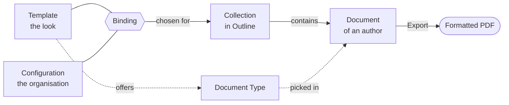

# Glossary

**Reference.** The words Outprint uses with a fixed meaning.

Four terms carry the product: Template, Configuration, Collection and Binding.
Document Type matters when you choose or make a Template.

## Template

The look of a PDF: page layout, fonts, and the kinds of document it can make,
such as a letter or a report. Think of it as letter paper that is ready to use.
The Templates that ship with Outprint are in the
[Template catalogue](../templates/catalogue/README.md).

## Configuration

The details of an organisation that go on every PDF: name, logo and colour. A
Template plus a Configuration gives your own letterhead. A document cannot
change a Configuration, which keeps every PDF looking the same.

## Collection

A collection in Outline, shown in the left sidebar. Every document in a
Collection, including documents in nested folders, gets the same PDF look.

## Binding

The choice of one Template and one Configuration for a Collection. A Collection
admin makes it once; authors do not choose it. A Collection without a Binding
has no Formatted PDF action. See
[Bind a Template to a Collection](../configure/README.md) and the
[Binding block](binding-block.md).

## Document Type

A kind of document that a Template offers, such as `letter` or `report`. Each
has its own layout and fields. An author picks it with `type` in the
[Metadata Block](metadata-block.md); a Configuration can set a default.
