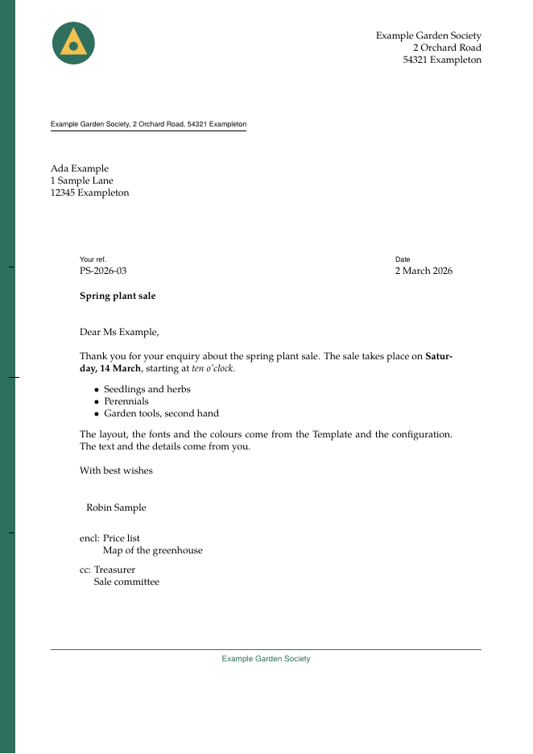

<!-- GENERATED by scripts/docs-catalogue from templates/neutral/manifest.yaml and configurations/example. Do not edit; run `task docs:catalogue`. -->

# The neutral Template

**Reference.** The neutral Template: its document types, fields and errors.

Document types: `letter`, `report`.



The picture is the first page of the `letter` example below, typeset with the real pipeline and the `example` configuration.

To use the Template, a Collection admin binds it to a Collection; see [Configure](../../configure/README.md). An author then starts a document with the block below.

## Document type `letter`

Copy this block to the very start of a document and replace the values. Lines that start with `#` are optional: remove the `#` to use them.

````markdown
```yaml
type: letter
# title: Spring plant sale
# date: 2026-03-02
language: en
author: Robin Sample
recipient:
  - Ada Example
  - 1 Sample Lane
  - 12345 Exampleton
sender:
  - 2 Orchard Road
  - 54321 Exampleton
subject: Spring plant sale
opening: Dear Ms Example,
closing: With best wishes
reference: PS-2026-03
enclosures:
  - Price list
  - Map of the greenhouse
cc:
  - Treasurer
  - Sale committee
```
````

### Fields

Types are explained in [Fill in the document](../../write/fill-in-the-document.md#what-each-kind-of-field-looks-like).

| Field | Type | Required | Default | Meaning |
|---|---|---|---|---|
| `title` | string | no | the Outline title | Document title. Defaults to the title of the Outline document. |
| `date` | date | no | the last-modified date | Date of the document. Defaults to the last-modified date. An ISO date (YYYY-MM-DD) is written out in the document language; any other text is printed as written. |
| `language` | string | no | `en` | Document language, which sets how dates are written and the PDF language. Allowed: `^(en\|de)$`. |
| `author` | string | no | none | Author. Signs a letter and appears in the title block of a report. |
| `recipient` | list | no | none | Address lines. The address window is shown only when this is set. |
| `sender` | list | no | none | Sender address lines, printed under the organisation name. |
| `subject` | string | no | the Outline title | Subject line. Defaults to the title of the Outline document; an empty value prints no subject line. |
| `opening` | string | no | none | Salutation. |
| `closing` | string | no | none | Complimentary close. |
| `reference` | string | no | none | Reference line, for example a file number. |
| `enclosures` | list | no | none | Enclosures, listed under the closing. |
| `cc` | list | no | none | Copy recipients, listed under the closing. |

The configuration `example` supplies defaults for `language` (en), `opening` (Dear Sir or Madam,), `closing` (Kind regards). A document can override each of them.

These fields are fixed by the configuration `example`. A document cannot set them, so they are not in the block.

| Field | Type | Value | Meaning |
|---|---|---|---|
| `name` | string | `Example Garden Society` | Organisation name, shown in the letterhead and the footer. |
| `logo` | asset | `logo.svg` | Logo shown in the letterhead, an SVG file in the Configuration. |
| `accent_color` | color | `2F6F5E` | Colour of the margin stripe and the footer rule, six hex digits. |

### Errors you can expect

Each message below was produced by the real checker from the mistake shown. The code links to its entry in [Error messages](../../reference/error-messages.md).

| Message | Cause | Fix |
|---|---|---|
| autor: unknown key "autor": not a field of document type "letter" (did you mean "author"?) ([unknown](../../reference/error-messages.md#unknown)) | A field name is misspelled, or the field does not exist in this document type. | Use the name the message suggests, or one from the field table. |
| language: "fr" does not match the field pattern ^(en\|de)$ ([type](../../reference/error-messages.md#type)) | The value does not match the allowed format of the field. | Use a value that matches the format in the field table. |
| author: must be text, not a list ([type](../../reference/error-messages.md#type)) | A list was written where one line of text is expected. | Write a single line of text. |
| type: unknown document type "memo" (available: letter, report) ([unknown](../../reference/error-messages.md#unknown)) | The type is not a document type of this Template. | Use one of the document types listed at the top of this page. |
| name: "name" is a Fixed Value of the Configuration and cannot be set in a Document ([unknown](../../reference/error-messages.md#unknown)) | The field is fixed by the configuration of the Collection. | Remove the line. To change the value, ask the Collection admin to change the configuration. |
| the metadata block is not closed (missing closing fence) ([block](../../reference/error-messages.md#block)) | The block has no closing line of three backticks. | Add a line with three backticks after the last field. |

## Document type `report`

Copy this block to the very start of a document and replace the values. Lines that start with `#` are optional: remove the `#` to use them.

````markdown
```yaml
type: report
title: Spring plant sale
# date: 2026-03-02
language: en
author: Robin Sample
subtitle: Results and plans
version: "1.0"
abstract: A short summary of the report, in *one* or two sentences.
toc: true
```
````

### Fields

Types are explained in [Fill in the document](../../write/fill-in-the-document.md#what-each-kind-of-field-looks-like).

| Field | Type | Required | Default | Meaning |
|---|---|---|---|---|
| `title` | string | yes | the Outline title | Document title. Defaults to the title of the Outline document. |
| `date` | date | no | the last-modified date | Date of the document. Defaults to the last-modified date. An ISO date (YYYY-MM-DD) is written out in the document language; any other text is printed as written. |
| `language` | string | no | `en` | Document language, which sets how dates are written and the PDF language. Allowed: `^(en\|de)$`. |
| `author` | string | no | none | Author. Signs a letter and appears in the title block of a report. |
| `subtitle` | string | no | none | Subtitle under the title. |
| `version` | string | no | none | Version of the report, printed under the date. |
| `abstract` | text | no | none | Summary printed before the body. Inline Markdown is allowed. |
| `toc` | bool | no | none | Print a table of contents. |

The configuration `example` supplies defaults for `language` (en). A document can override each of them.

These fields are fixed by the configuration `example`. A document cannot set them, so they are not in the block.

| Field | Type | Value | Meaning |
|---|---|---|---|
| `name` | string | `Example Garden Society` | Organisation name, shown in the letterhead and the footer. |
| `logo` | asset | `logo.svg` | Logo shown in the letterhead, an SVG file in the Configuration. |
| `accent_color` | color | `2F6F5E` | Colour of the margin stripe and the footer rule, six hex digits. |

### Errors you can expect

Each message below was produced by the real checker from the mistake shown. The code links to its entry in [Error messages](../../reference/error-messages.md).

| Message | Cause | Fix |
|---|---|---|
| autor: unknown key "autor": not a field of document type "report" (did you mean "author"?) ([unknown](../../reference/error-messages.md#unknown)) | A field name is misspelled, or the field does not exist in this document type. | Use the name the message suggests, or one from the field table. |
| title: required field "title" is empty ([required](../../reference/error-messages.md#required)) | A required field is empty or missing. | Give the field a value. |
| language: "fr" does not match the field pattern ^(en\|de)$ ([type](../../reference/error-messages.md#type)) | The value does not match the allowed format of the field. | Use a value that matches the format in the field table. |
| title: must be text, not a list ([type](../../reference/error-messages.md#type)) | A list was written where one line of text is expected. | Write a single line of text. |
| type: unknown document type "memo" (available: letter, report) ([unknown](../../reference/error-messages.md#unknown)) | The type is not a document type of this Template. | Use one of the document types listed at the top of this page. |
| name: "name" is a Fixed Value of the Configuration and cannot be set in a Document ([unknown](../../reference/error-messages.md#unknown)) | The field is fixed by the configuration of the Collection. | Remove the line. To change the value, ask the Collection admin to change the configuration. |
| the metadata block is not closed (missing closing fence) ([block](../../reference/error-messages.md#block)) | The block has no closing line of three backticks. | Add a line with three backticks after the last field. |

