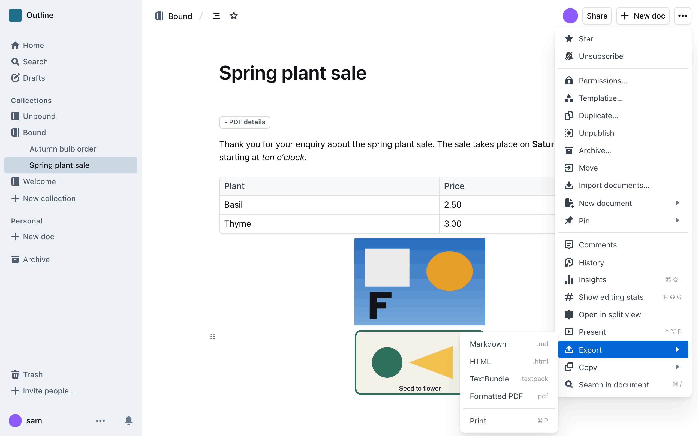
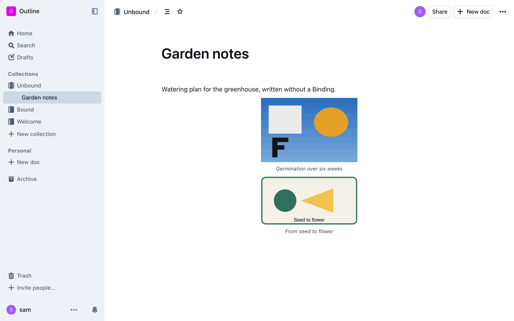
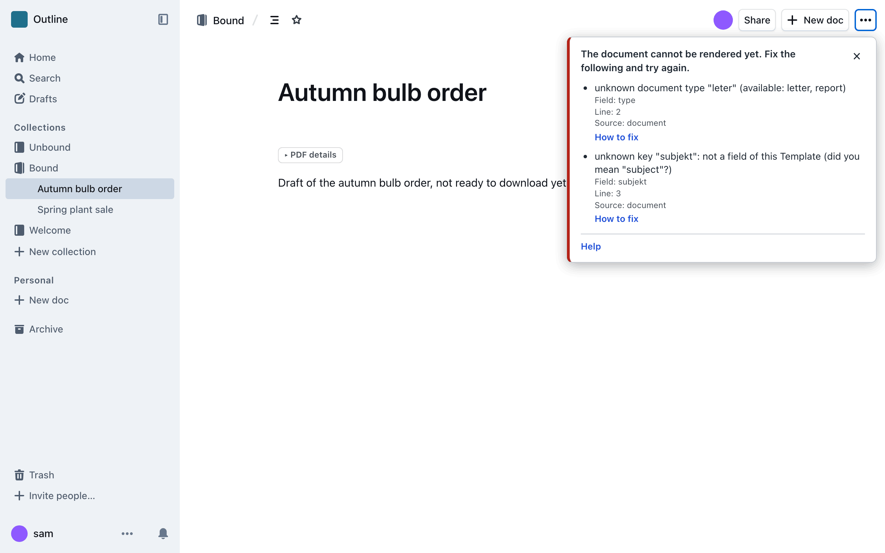

# Download a PDF

This takes about five minutes. You need an Outline account and a document in a
Collection that has a PDF look.

## 1. Open a document

Open any document in your Collection. If the Collection is set up for PDFs, a
**Download PDF** button appears at the bottom right of the page.

## 2. Click the button

Click **Download PDF**. The button is disabled while the PDF is made. This takes
a few seconds. Your browser then saves the file, like any other download.

Open the PDF. The title of the document is the title of the PDF. The date is the
day the document was last changed.

## 3. If there is no button

No button means that the Collection has no PDF look yet.

Ask the admin of the Collection to set one up. The admin finds the steps in
[Configure](../configure/README.md).

## 4. Add the details

A plain document already makes a PDF. A letter also needs a recipient and a
subject. You write them in a short block at the top of the document. See
[Fill in the document](fill-in-the-document.md).

## 5. If a message appears

If something is wrong with the document, a message appears instead of the
download. It says what to fix and where.

Fix the problem and click the button again. Find your message in
[When something goes wrong](when-something-goes-wrong.md).

## Good to know

- The PDF shows the document as it is saved now.
- Nothing is stored. Every click makes a new PDF.
- You can only download PDFs of documents you are allowed to read.
