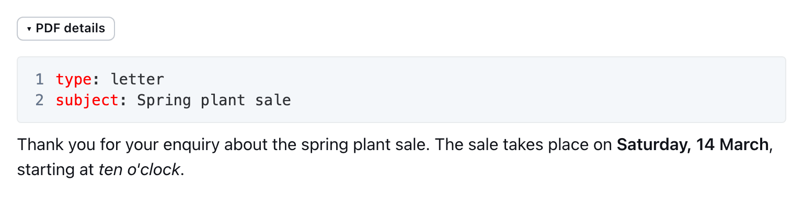
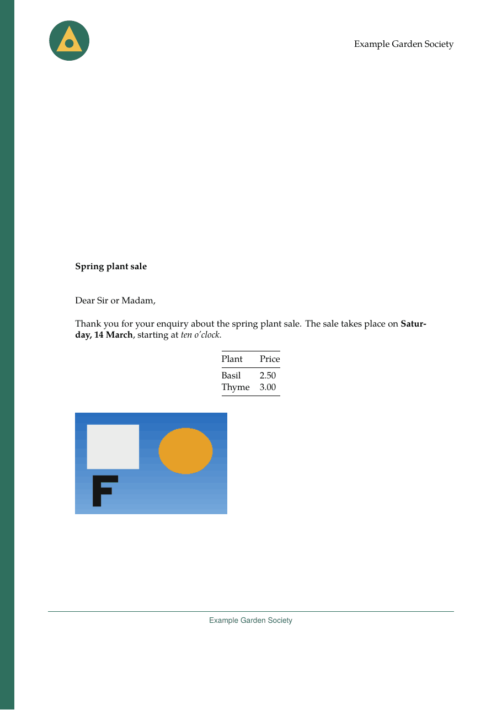

# Fill in the document

A letter needs a recipient and a subject. A report needs a title and maybe a
table of contents. You write these details in a small block at the very start of
your document. Outprint calls it the **metadata block**. It does not appear in
the PDF as text. Outprint reads it and puts each detail in the right place.

## Start from a ready-made block

Do not write the block from scratch. Copy one.

1. Ask your Collection admin which Template your Collection uses, or look at the
   [Template catalogue](../templates/catalogue/README.md). Every Template has a
   page there.
2. Open the page of your Template and copy the block of the document type you
   want, for example `letter`.
3. Paste it at the very start of your document, above everything else.
4. Replace the example values with your own.

The first Template that ships with Outprint is
[neutral](../templates/catalogue/neutral.md). Its letter block looks like this:

<!-- validate: metadata template=neutral configuration=example -->
````markdown
```yaml
type: letter
# title: Spring plant sale
# date: 2026-03-02
language: en
author: Robin Sample
recipient:
  - Ada Example
  - 1 Sample Lane
  - 12345 Exampleton
sender:
  - 2 Orchard Road
  - 54321 Exampleton
subject: Spring plant sale
opening: Dear Ms Example,
closing: With best wishes
reference: PS-2026-03
enclosures:
  - Price list
  - Map of the greenhouse
cc:
  - Treasurer
  - Sale committee
```
````

The text of your letter follows below the block, as in any Outline document.



The result is a letter with the recipient in the address window, the subject in
bold, and your text below.



## How to make the block in Outline

The block is a code block. In Outline, type three backticks to start one, then
choose **YAML** as its language. Type or paste the lines inside.

Three rules keep it working:

- The block must be the first thing in the document. A blank line before it is
  fine. Text before it is not.
- The language must be **YAML**, nothing else.
- Only the first block counts. A second YAML block further down is shown as
  normal text. That is useful when you want to show an example in a document.

A document without a block still works, as long as the Template does not need
any detail that has no default.

## Where did my block go?

In a document that has a Template, Outline can keep the block out of the way.
Your block is still there, and Outprint still reads it.

- If you can edit the document, the block is folded behind a line above the
  document called **PDF details** (**PDF-Details** in the German interface). Click
  it to open the block and click it again to fold it. Each document starts
  folded.
- If you can only read the document, you do not see the block at all.

Your Outprint admin can change this, so that the block is always shown to you
([Injector and PDF action](../deploy/injector.md#hiding-the-metadata-block)).
Two places still show the block: a link that you share from Outline, and
Outline's own export and search.

## Lines that start with `#`

A line that starts with `#` is a comment. Outprint ignores it. The ready-made
blocks use comments for details that Outprint fills in for you, such as the
title and the date. Remove the `#` to set the value yourself.

## What each kind of field looks like

Every line in the block is a **field**: a name, a colon, a space and a value.
The name stays as it is. You change the value. A field has one of these kinds.

| Kind | What it is | How you write it |
|------|------------|------------------|
| One line of text | A subject, a reference, an author | `subject: Spring plant sale` |
| A longer text | A summary of a report, with **bold**, *italics*, links and lists | `abstract: A short summary of *this* report.` |
| A list | Address lines, enclosures, copy recipients | One `-` per item, indented by two spaces, as in `recipient` above. You can also write several lines of text; each line becomes one item. |
| A date | The date of the document | `date: 2026-03-02` (year, month, day), or any text such as `date: spring 2026`, which is printed as you wrote it |
| Yes or no | A switch, such as the table of contents | `toc: true` or `toc: false` |
| A choice | A value from a short list of allowed values | The page of your Template lists the values. Write one of them exactly. |
| Colour, logo | Set by the Configuration, not by you | You do not write these |

A value must fit its field. Outprint never guesses. A list where one line of
text is expected is a mistake, and Outprint tells you.

### Text that contains a colon

A colon followed by a space has a special meaning in the block. If your text
contains one, put the whole value in quotation marks:

<!-- validate: metadata template=neutral configuration=example -->
````markdown
```yaml
type: letter
subject: "Re: spring plant sale"
```
````

Without the quotation marks, the block is broken and Outprint reports a
[`block`](when-something-goes-wrong.md#block) problem. Quotation marks are also
a good idea for a value that starts with a special character such as `#`, `*`,
`&`, `[` or `{`.

### A plain text field is plain

Only longer text fields accept formatting. In a one-line field, stars, dollar
signs and backslashes print as you typed them. This protects the layout.

## The kind of document

The line `type: letter` chooses the kind of document. `letter` and `report`
are the kinds the neutral Template offers. The kind decides which other fields
exist. If your Collection admin has chosen a default kind, you can leave `type`
out. A kind that the Template does not know is an error.

## Defaults, and what you cannot change

Details come from several places. When two places set the same field, the first
place in this list wins.

1. **The Configuration.** Some fields are fixed, for example the organisation
   name, the logo and the colour. You cannot set them in a document. If you try,
   Outprint says so.
2. **Your block.** What you write.
3. **The Configuration's defaults.** A Configuration may set a salutation or a
   closing for you. Your block wins over these.
4. **Outprint.** The title of the Outline document (also used as the subject of
   a letter) and the date of the last change.
5. **The Template.** Its own defaults, such as the language.

To remove a default, leave the value empty: `closing:` removes the closing.
If the field is required, an empty value is an error.

A letter without a `subject` uses the title of the document as its subject. Write
`subject:` or `subject: ""` to print no subject line at all.

## Common fields

These names mean the same in every Template that uses them. The Template page in
the [catalogue](../templates/catalogue/README.md) lists the exact fields of each
Template.

| Field | Used for |
|-------|----------|
| `title` | The title of the document |
| `date` | The date of the document |
| `language` | The language of the document, for example `en` or `de`. It sets how dates are written. |
| `author` | Who wrote it |
| `recipient`, `sender` | Address lines of a letter |
| `subject`, `reference` | Subject line and reference of a letter. Without `subject`, the document title is the subject |
| `opening`, `closing` | Salutation and closing of a letter |
| `enclosures`, `cc` | Lists below a letter |
| `subtitle`, `version`, `abstract`, `toc` | Parts of a report |

## Check your block

Click **Formatted PDF**. Outprint checks the whole block and reports all problems
at once, each with its line. A name that is almost right gets a hint, such as
`did you mean "recipient"?`. Find the message in
[When something goes wrong](when-something-goes-wrong.md).
