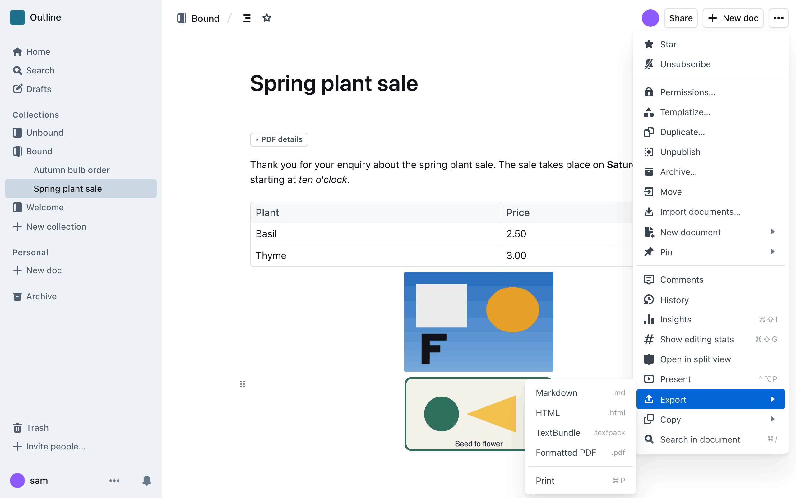
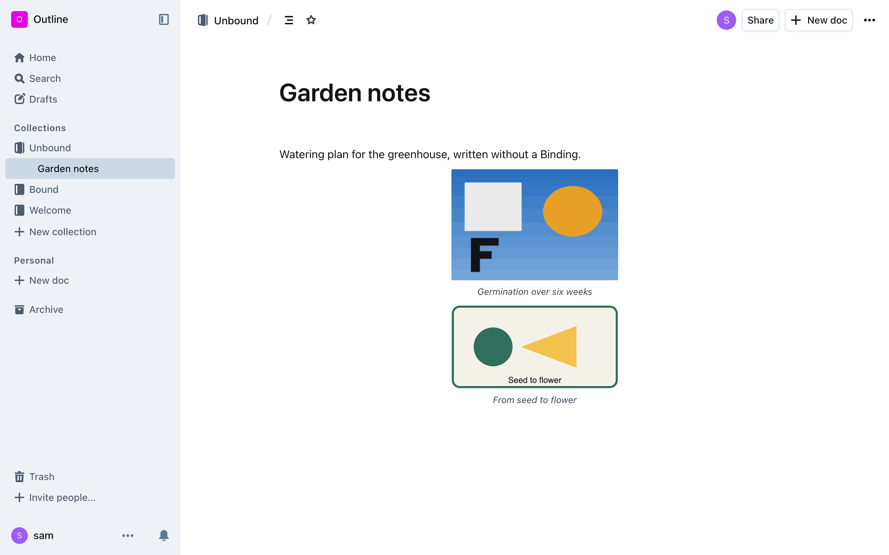
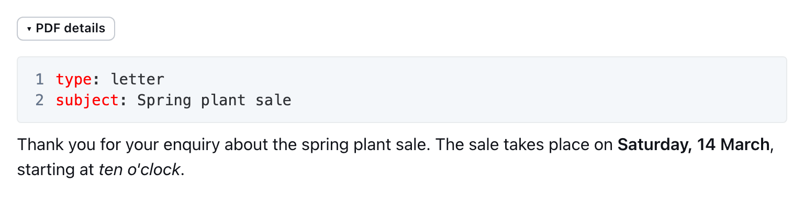
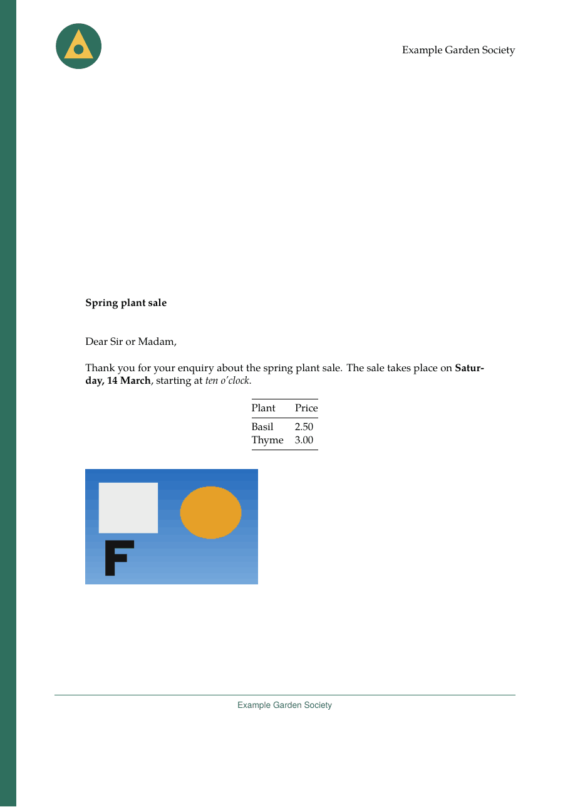
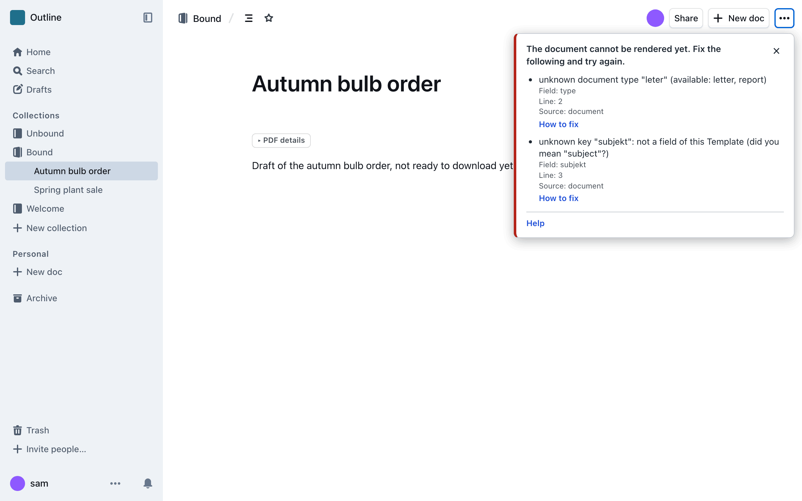

# Get a PDF

**How-to.** Download a document from Outline as a PDF, fill in the details at its top, and start new documents with them in place.

You need an Outline account and a document in a Collection that has a PDF look.

## Download

Open a document, open the **…** menu at the top right, then **Export**, and click
**Formatted PDF**. A small message under the **…** button says the PDF is being
made. After a few seconds your browser saves the file like any other download.



The title of the document is the title of the PDF, and the date is the day the
document was last changed. The PDF shows the document as saved now, nothing is
stored, and you can only download documents you may read.

No **Formatted PDF** item means the [Collection](../reference/glossary.md#collection)
has no [Binding](../reference/glossary.md#binding) yet. Ask its admin to
[bind a Template](../configure/README.md).



## Fill in the details at the top

A plain document already makes a PDF. A letter also needs a recipient and a
subject. You write them in a block at the very start of the document, the
**metadata block**. It does not print as text: Outprint reads it and puts each
detail in the right place.

1. Open the page of your Template in the
   [Template catalogue](../templates/catalogue/README.md) and copy the block of
   the [Document Type](../reference/glossary.md#document-type) you want, for
   example `letter`.
2. Paste it at the very start of your document and replace the example values.

<!-- validate: metadata template=neutral configuration=example -->
````markdown
```yaml
type: letter
language: en
author: Robin Sample
recipient:
  - Ada Example
  - 1 Sample Lane
  - 12345 Exampleton
subject: Spring plant sale
opening: Dear Ms Example,
closing: With best wishes
```
````

Your text follows below the block, as in any Outline document.





To make the block in Outline, type three backticks and choose **YAML** as the
language. The block must be the first thing in the document, and only the first
block counts. A line that starts with `#` is a comment. Put a value that contains
a colon, such as `"Re: sale"`, in quotation marks.

Fixed details such as the organisation name, logo and colour come from the
Collection's [Configuration](../reference/glossary.md#configuration). You cannot set them in a document. Every field, its
type and the order of the defaults are in the
[Metadata Block](../reference/metadata-block.md) reference and the catalogue.

If you can edit the document, Outline may fold the block behind a line called
**PDF details** (**PDF-Details** in German). Click it to open the block. Readers
who cannot edit do not see the block. Your admin can change this.

## Start new documents with the block in place

Outline's own **templates** give every new document a first draft. A template
that starts with the block saves everyone from typing it.

1. In Outline's **Settings** choose **Templates**, then **New template…**, and
   make it a template of the Collection.
2. Start it with a **YAML** block that holds the details most documents share
   and placeholders for the rest. `{author}` becomes the name of the person who
   makes the document.
3. An author creates a document with **New doc** and chooses the template from
   the **Templates** menu at the top. Do this in a new, empty document: a second
   block would print as text.

Leave out what the Configuration already supplies, such as the logo. The block is
checked when someone clicks **Formatted PDF**, so make a document from your
template once and download it. A template is copied when the document is made;
changing it later does not change existing documents.

## If a message appears

If something is wrong with the document, a message appears instead of the
download. It says what to fix and where.



Fix the problem and click **Formatted PDF** again. Find the message in
[Error messages](../reference/error-messages.md).

## How it differs from Outline's own PDF

Outline can export a plain PDF itself when its operator turns that on. That entry
is called **PDF** and prints the document as the browser shows it, with no
Template. **Formatted PDF** is Outprint's: it uses the Template and Configuration
of the Collection, so letterhead, fonts and layout are the same every time.
