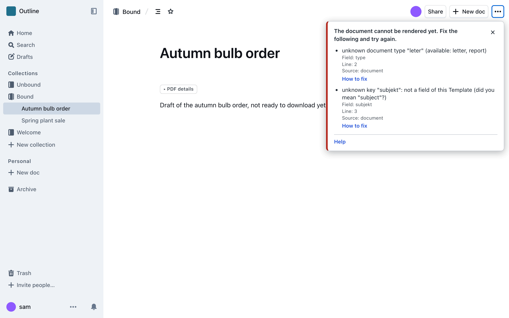

# When something goes wrong

**Reference.** The messages Outprint shows when it cannot make a PDF, and what each one means.

If Outprint cannot make your PDF, it shows a message instead of the download.
Find the message on this page. Each entry says what the message means and what
to do.

Every kind of problem has a short name, called its **code**. The message
usually shows the code. Search this page for it. The code is also the link
target: `#no_binding` leads to the entry for `no_binding`.

## How to read a message

- **Line numbers** count from the first line of the document. The line is where
  the problem starts.
- **All problems come at once.** Fix everything the message lists, then click
  the button again.
- **How to fix** next to a problem links to its entry on this page, in the
  docs of the Outprint version that is running.
- **A hint** such as `did you mean "recipient"?` is almost always right.
- **A job number** appears for some failures. Give it to the person who runs
  Outprint. It finds the failure in the log.

The first word of a problem tells you who fixes it.

| Source | Who fixes it |
|--------|--------------|
| `document` | You. The problem is in your document. |
| `collection` | The admin of your Collection. See [Configure](../configure/README.md). |
| `configuration`, `template` | The admin of your Collection, or the person who made the Template. |
| `service` | Nobody. Wait a moment and try again. |

## How this list was made

The list is complete. It is derived from the source code, not written from
memory. A code is any short name that Outprint can put in an error list (the
`code` of a problem), or use as the kind of any other failure. The script
`scripts/docs-error-codes.sh` collects them from these files:

- `internal/metadata/errors.go`: problems in the block at the top of a document.
- `internal/images/kinds.go`: problems with images.
- `internal/binding/binding.go`: problems in the PDF setup of a Collection.
- `internal/gateway/admit.go` and `internal/gateway/errors.go`: a busy service,
  and failures of the service that are not about your document.
- `internal/workerapi/workerapi.go` and `internal/worker/error.go`: failures
  while the PDF is made.

The task `task docs:errors-check` compares that list with the headings of this
page. It fails if a code has no entry here, or if an entry names a code that
does not exist. A heading is the anchor of its entry, so links to it stay valid.

## Problems in your document

These messages come as a list, one line per problem, each with a line number.

### `block`

**Message:** `the metadata block is not closed (missing closing fence)`, or
`invalid YAML in the metadata block: ...`, or `key "subject" appears twice`.

**Cause:** The block at the top of the document is broken. A closing line of
three backticks is missing, a line is not written as `name: value`, or a field
name appears twice.

**What to do:** Check the lines the message points to. Close the block with
three backticks on a line of their own. Put a value that contains a colon and a
space in quotation marks. See [Fill in the document](fill-in-the-document.md).

### `required`

**Message:** `required field "title" is missing`, or `required field "title" is empty`.

**Cause:** The Template needs this detail and the document has none. An empty
value counts as missing.

**What to do:** Add the field to the block and give it a value.

### `unknown`

**Message:** `unknown key "recipent": not a field of document type "letter" (did you mean "recipient"?)`.

Other messages with this code: `unknown document type "memo" (available: letter, report)`
and `"name" is a Fixed Value of the Configuration and cannot be set in a Document`.

**Cause:** Outprint does not know the name. You misspelled a field, used a field
that this kind of document does not have, or tried to set a detail that the
Collection fixes, such as the organisation name or the logo.

**What to do:** Use the name from the hint, or one from the page of your
Template in the [catalogue](../templates/catalogue/README.md). For a fixed
detail, delete the line. To change it, ask your Collection admin.

### `type`

**Message:** `must be text, not a list`, `must be a single line`, `must be true or false`,
or `"fr" does not match the field pattern ^(en|de)$`.

**Cause:** The value has the wrong shape for its field. Outprint never guesses.
A list where one line of text belongs is a mistake, and so is a value outside
the allowed format.

**What to do:** Write the value the way the field expects. The page of your
Template shows the kind of each field. See
[what each kind of field looks like](fill-in-the-document.md#what-each-kind-of-field-looks-like).

### `enum`

**Message:** `"middle" is not one of left, right`.

**Cause:** The field accepts only a fixed set of values.

**What to do:** Write one of the values the message lists, exactly as shown.

### `missing`

**Message:** `the image has no address`, `the image was not found; it may have been deleted`,
or `the attachment id is not valid`.

**Cause:** An image in the document points to nothing, or the file is gone from
Outline.

**What to do:** Delete the image and upload it again. See
[Images and logos](images-and-logos.md).

### `forbidden`

**Message:** `this address is not an Outline attachment; ...`,
`images from other sites are not allowed; ...`, or `you are not allowed to read this image`.

**Cause:** Outprint only uses images that you uploaded to Outline. An image
linked from another website is refused. So is an image you may not read.

**What to do:** Download the picture and upload it to the document. If you may
not read the image, ask its owner for access.

The same code appears as a single sentence: `you are not allowed to read this document`.
That means Outline refused you the document itself. Ask the document owner for
access.

### `too_large`

**Message:** `the image is larger than 10 MiB`, `the document has more than 50 images`,
`the images of this document together exceed 50 MiB`, or `the document is too large to render`.

**Cause:** A limit was passed. See [Limits you may hit](limits-you-may-hit.md).

**What to do:** Shrink the image, use fewer images, or split the document in two.
The message says which limit it is.

### `format`

**Message:** `this is not a supported image (detected: ...)`, or `animated GIF is not supported; ...`.

**Cause:** Outprint accepts PNG, JPEG, WebP, GIF (not animated) and SVG. The
file is something else, or it is an animation.

**What to do:** Export the picture as PNG or JPEG and upload it again.

### `decode`

**Message:** `the png image could not be decoded`, or `the jpeg image header is not valid`.

**Cause:** The file has a supported format but is damaged.

**What to do:** Open the image on your computer. If it opens, save it again and
upload the new file.

### `pixels`

**Message:** `the image is 9000 x 6000 pixels (54 megapixels), at most 40 megapixels`.

**Cause:** The picture has more pixels than Outprint processes.

**What to do:** Scale the picture down before you upload it. Half the width is
usually still sharp on paper.

### `svg_rejected`

**Message:** Starts with `the SVG` and names the reason, for example
`the SVG has a <script> element, which is not allowed`.

**Cause:** An SVG picture contains something that is not safe, such as a script
or a link to another file, or it is not valid. The message names the reason.

**What to do:** Export the SVG again from your drawing program, without scripts
and links, and save it as UTF-8. As a quick fix, export a PNG instead.

### `syntax`

**Message:** `... put the image on a single line`.

**Cause:** The picture is written across several lines of text. Outprint cannot
place it with certainty.

**What to do:** Put the picture on a line of its own. In Outline, delete the
picture and insert it again.

## Problems with the PDF setup of the Collection

These messages say `collection`. The admin of the Collection fixes them. If you
are the admin, see [Choose a Template and Configuration](../configure/choose-a-template.md).

### `no_binding`

**Message:** `no binding: this installation has no default Binding and the Document's Collection has none`.

**Cause:** Nobody has chosen a Template and Configuration for this Collection.

**What to do:** Ask the Collection admin to set it up.

### `binding_malformed`

**Message:** `the binding block is not closed (missing closing fence)`,
`missing key "configuration"`, or `invalid YAML in the binding block: ...`.

**Cause:** The setup block in the Collection description is written wrongly.

**What to do:** The admin compares the block with the example on
[Choose a Template and Configuration](../configure/choose-a-template.md).

### `binding_unknown`

**Message:** `unknown template "neutrall"`, or `unknown configuration "exampel"`.

**Cause:** A name in the setup block does not match an installed Template or
Configuration.

**What to do:** The admin corrects the spelling. The name must match exactly.

### `binding_not_allowed`

**Message:** `template "neutral" with configuration "example" is not allowed on this installation`.

**Cause:** Both names exist, but the person who runs Outprint has not allowed
this pair.

**What to do:** The admin picks an allowed pair, or asks the operator to allow
the pair.

### `binding_duplicate`

**Message:** `second binding block: a Collection overview has at most one`.

**Cause:** The Collection description holds two setup blocks.

**What to do:** The admin deletes one of them.

## The service is busy

### `busy`

**Message:** `busy, retry later: the renderer is at capacity`.

**Cause:** Many people are making PDFs right now. Nobody did anything wrong.

**What to do:** Wait a few seconds and click the button again.

### `user_limit`

**Message:** `busy, retry later: you already have a render in progress`.

**Cause:** Outprint makes one PDF at a time for each person. You started a
second one before the first was done.

**What to do:** Wait until the first PDF is finished, then try again.

## Failures that show one sentence

These do not come as a list. You see one sentence. Some also show a phase, the
step that failed, and a job number. The entries below name the phase where it
helps.

### `bad_document_id`

**Message:** `invalid document id`.

**Cause:** The address of the document is damaged.

**What to do:** Open the document from Outline again and retry.

### `unauthorized`

**Message:** `sign in to Outline to download this document`.

**Cause:** Your Outline session has ended.

**What to do:** Reload the page, sign in, and click the button again.

### `not_found`

**Message:** `document not found`.

**Cause:** The document was deleted, or you may not see it.

**What to do:** Check that the document still exists.

### `collection_forbidden`

**Message:** `you are not allowed to read the collection that holds this document's binding`.

**Cause:** You may read the document, but not its Collection. Outprint cannot
read the PDF setup of the Collection.

**What to do:** Ask the Collection admin for access.

### `collection_not_found`

**Message:** `the collection that holds this document's binding was not found`.

**Cause:** Outprint cannot find the Collection of the document.

**What to do:** Reload the page. If the message stays, tell the person who runs
Outprint.

### `timeout`

**Message:** `rendering took too long; shorten the document`, or
`fetching the images took too long`.

**Cause:** The PDF took longer than allowed.

**What to do:** Shorten the document, use fewer or smaller images, or try again.

### `pages_exceeded`

**Message:** `the document has too many pages; shorten it`.

**Cause:** The PDF would have more pages than allowed.

**What to do:** Split the document in two.

### `pdf_too_large`

**Message:** `the resulting PDF is too large; remove or shrink images`.

**Cause:** The finished PDF is larger than allowed, usually because of images.

**What to do:** Remove images or scale them down.

### `output_too_large`

**Message:** `an SVG image is too complex to convert; simplify it or export it as PNG`.

**Cause:** An SVG picture is valid but too complex to turn into print.

**What to do:** Simplify the drawing, or export it as PNG.

### `resource`

**Message:** `the document needs more memory or space than the renderer allows; simplify it`.

**Cause:** The document used up the memory that Outprint gives to one PDF. A very
large table or picture is the usual reason.

**What to do:** Simplify the document, or split it. If it keeps happening with a
small document, tell the operator.

### `svg_convert`

**Message:** `the document could not be rendered`, phase `svg`.

**Cause:** An SVG picture, or the logo, could not be turned into print.

**What to do:** Export the SVG again, or use PNG. If the document has no SVG,
the logo of the Configuration fails: tell the operator.

### `tex_error`

**Message:** `the document could not be rendered`, phase `tex`.

**Cause:** The layout program stopped. A special character or an unusual
construction in the text often upsets it.

**What to do:** Undo your last changes to find the cause. Send the job number to
the operator, who finds the exact reason in the log. The log stays on the
server, so no document text travels with the message.

### `no_output`

**Message:** `the document could not be rendered`, phase `tex`.

**Cause:** The layout program ended without a PDF.

**What to do:** Retry once. Then send the job number to the operator.

### `tool_failed`

**Message:** `the document could not be rendered`, phase `pandoc`.

**Cause:** The step that reads the text of the document failed.

**What to do:** Retry once, then send the job number to the operator.

### `raw_tex`

**Message:** `the document could not be rendered`, phase `filter`.

**Cause:** The document holds raw layout code. Outprint refuses it for safety.

**What to do:** Remove the unusual markup. Use normal Outline formatting.

### `raw_format`

**Message:** `the document could not be rendered`, phase `filter`.

**Cause:** The document holds raw HTML or another raw format. Outprint refuses
it for safety.

**What to do:** Remove the raw HTML. Use normal Outline formatting.

### `math`

**Message:** `the document could not be rendered`, phase `filter`.

**Cause:** The document holds a formula that Outprint does not print.

**What to do:** Remove the formula, or write it as plain text.

### `image_path`

**Message:** `the document could not be rendered`, phase `filter`.

**Cause:** An image points somewhere other than one of the document's own
pictures. The image checks normally catch this first.

**What to do:** Delete the image and upload it again.

### `invalid_job`

**Message:** `the document could not be rendered`, phase `setup`.

**Cause:** The service built a request that the PDF step refused. This is a
fault of Outprint, not of your document.

**What to do:** Tell the operator, with the job number.

### `invalid_bundle`

**Message:** `the document could not be rendered`.

**Cause:** The service sent the PDF step a damaged package of files. This is a
fault of Outprint.

**What to do:** Tell the operator.

### `invalid`

**Message:** `the document could not be rendered`, phase `bundle`.

**Cause:** The service could not pack your document and its pictures.

**What to do:** Retry once, then tell the operator.

### `missing_package`

**Message:** `the document could not be rendered`, phase `binding`.

**Cause:** The Collection names a Template or Configuration that the service
could not load.

**What to do:** Tell the Collection admin and the operator.

### `internal`

**Message:** `the document could not be rendered`.

**Cause:** An unexpected fault in Outprint. Your document did not cause it.

**What to do:** Retry once. Then tell the operator, with the job number if there
is one.

### `unavailable`

**Message:** `the document could not be rendered`, phase `outline`, `binding` or `images`.

**Cause:** Outprint got no answer from Outline, or Outline answered with an
error.

**What to do:** Retry in a minute. If it stays, tell the operator.

### `unreachable`

**Message:** `the document could not be rendered`, phase `worker`.

**Cause:** The part of Outprint that makes the PDF does not answer.

**What to do:** Retry in a minute. If it stays, tell the operator.

### `canceled`

**Message:** `the request was canceled`.

**Cause:** You closed the page or stopped the download before the PDF was ready.

**What to do:** Nothing. Click the button again when you want the PDF.
