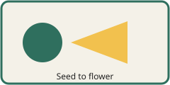

```yaml
type: report
title: Vector figures
author: Robin Sample
```
# Diagrams

An SVG alone in its paragraph with alt text becomes a captioned figure and stays a vector.



The same file at the width an author asked for, without a caption.


An inline SVG  sits in a line of text, with both sides given.

- 
